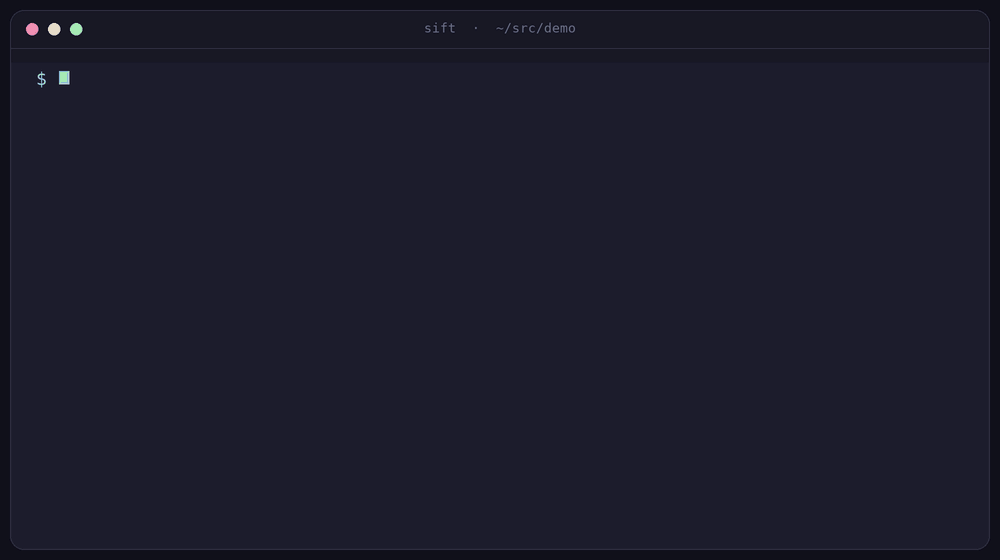

# SPDX-License-Identifier: MIT
# Copyright © Josep Bigorra <jjbigorra@gmail.com>

#+title: sift
#+subtitle: a formatter, linter and language server for Scheme, Emacs Lisp and Common Lisp
#+author: Josep Bigorra
#+email: jjbigorra@gmail.com
#+options: toc:2 num:nil
#+language: en
#+description: A dialect-aware formatter, linter and language server for Scheme, Emacs Lisp and Common Lisp. Formats and lints without ever losing a comment, a blank line or an apostrophe.
#+keywords: scheme emacs-lisp common-lisp formatter linter lsp guile emacs

*The Lisp formatter, linter and language server that never loses a byte.*

[[https://github.com/jjba23/sift/actions/workflows/ci.yml][https://github.com/jjba23/sift/actions/workflows/ci.yml/badge.svg]] [[https://github.com/jjba23/sift/releases][https://img.shields.io/badge/release-1.10.0-2f6f4f.svg]] [[https://opensource.org/license/mit][https://img.shields.io/badge/license-MIT-2f6f4f.svg]] [[https://www.gnu.org/software/guile/][https://img.shields.io/badge/Guile-3.0%2B-1e5b3a.svg]] [[https://github.com/jjba23/guix-jointhefreeworld][https://img.shields.io/badge/Guix-channel-6f4e9c.svg]] [[https://github.com/jjba23/nix-jointhefreeworld][https://img.shields.io/badge/Nix-flake-5277c3.svg]] [[https://microsoft.github.io/language-server-protocol/][https://img.shields.io/badge/LSP-server-2f6f4f.svg]] [[file:doc/rules.org][https://img.shields.io/badge/rules-59-2f6f4f.svg]]

sift reads a Lisp file, tells you what is wrong with it, and rewrites the
whitespace — and it does that without ever losing a comment, a blank line or
an apostrophe.

It understands and enforces good practices in: Lisp, Scheme, Emacs Lisp and Common Lisp.

Install it with ~guix install sift~ (or ~nix run~), or
[[#quick-start][clone the repository]] and run ~./bin/sift version~: Guile 3.0 is
all it needs, and ~sift doctor~ will tell you what it found.

It is also a language server (~sift lsp~), which means the same findings, the
same fixes and the same formatting reach Emacs through Eglot, Neovim, and any
editor that speaks LSP — one integration instead of four.

sift is written in Guile Scheme, ships as one executable plus one Emacs
package, and is licensed MIT.  It is for people who have decided that Lisp is
worth formatting properly, and who would like the formatter to agree.

#+begin_quote
*Check, format, lint — three questions, one reader.*  ~sift check~ prints the
patch it would make and exits 1; ~sift format~ prints the formatted file;
~sift lint~ names the rule that fired, its severity and its position.  These
are the same answers your editor and your pipeline get.  Every line in that
recording is real output, on files small enough to read in the picture.
#+end_quote

* Who it is for
:PROPERTIES:
:CUSTOM_ID: audience
:END:

- *Guile and Guix hackers* whose ~cond~ clauses are written with square
  brackets, and who want a formatter that agrees with the code base next door
  instead of re-deciding it.
- *Emacs package authors* who want the docstring, ~lexical-binding~,
  ~interactive~ and ~provide~ rules in Flymake *and* in CI, from one tool
  instead of three.
- *Common Lisp projects* that would like package prefixes, ~LOOP~ keyword
  style and dangling parentheses respected rather than normalised away.
- *Maintainers of polyglot Lisp repositories* who would rather have one
  executable, one configuration file and one CI step than three of each.
- *Editor and tool authors* who need the findings as data: ~--format=json~,
  ~--format=sarif~, GitHub annotations, or ~sift lsp~.

#+begin_quote
If you have ever skipped reformatting a Lisp file because the formatter would
eat a comment, this is for you.
#+end_quote

* Why you might want it
:PROPERTIES:
:CUSTOM_ID: why
:END:

- *It never loses a byte.*  Comments, blank lines, ~#;~ datum comments,
  ~#.~ read-time forms and ~#<...>~ objects all come back exactly as they
  went in.  Formatting is a fixed point: run it twice and the second run
  changes nothing, which is asserted over every fixture in the test suite.
- *It knows which dialect it is looking at.*  Three dialects, one tool:
  character literals, read macros, ~#| ... |#~ block comments, ~#;~ datum
  comments, package prefixes, LOOP and docstring conventions follow the
  dialect rather than a compromise.  So does a square bracket, which is a
  vector in Emacs Lisp and a clause in Scheme, and ~#{ ... }#~, which is a
  symbol and only Guile reads.  Guile is what sift is written in and the
  dialect it knows best; the others are read, not guessed at.
- *Three jobs, three commands.*  Formatting, linting and fixing are separate
  on purpose: ~format~ prints, ~--write~ writes, ~lint~ reports, ~lint --fix~
  fixes, and ~ci~ asks the formatting question and the lint question in one
  go without ever touching the tree.
- *Fifty rules that say why.*  Every rule has a name, a stable code
  (~SIFT012~), a sentence, the dialects it applies to, an example, and its own
  test file.  ~sift explain RULE~ reads the reasoning from the program;
  [[file:doc/rules.org][doc/rules.org]] is the same thing as a book, generated from the rules
  themselves.
- *Fixes that refuse to guess.*  A rule's fix replaces exactly one range, and
  every fix of a run is thrown away if together they would introduce a parse
  error.  Nothing invents a missing delimiter, and nothing renames your code.
- *One language server, every editor.*  ~sift lsp~ speaks LSP over standard
  input and output: diagnostics, quickfixes and formatting, go to definition
  and references for all three dialects, an outline, completion, and a hover
  that describes a symbol or the rule under it.
- *Output for humans, editors and pipelines.*  The compile-style line that
  ~:make~ and ~compilation-mode~ parse, JSON for editors that want structure,
  SARIF 2.1.0 for code scanning, GitHub annotations for a pull request, and
  ~null~ for a script that only cares about the exit status.
- *Configuration you can check in.*  YAML that is data and never code, four
  layers from system to command line, and ~sift config show --verbose~ that
  tells you which layer won.
- *MIT, no strings.*  A formatter belongs in as many pipelines as possible
  without a copyright question in the way.

* A thirty-second tour
:PROPERTIES:
:CUSTOM_ID: quick-start
:END:

You need Guile 3.0 and nothing else.  Clone, and the launcher inside the
checkout runs the thing:

#+begin_src shell
git clone https://github.com/jjba23/sift.git
cd sift
./bin/sift version
#+end_src

Now a file that needs work:

#+begin_src shell
$ cat square.scm
(define (square x)
(* x x))

$ sift check square.scm
--- square.scm
+++ square.scm
@@ -1,2 +1,2 @@
 (define (square x)
-(* x x))
+  (* x x))
$ echo $?
1
#+end_src

~check~ answered the pipeline question — "would anything change?" — with a
status and a patch, and wrote nothing.  To make the change:

#+begin_src shell
$ sift format --write square.scm
$ sift check square.scm; echo $?
0
#+end_src

A file with something to say:

#+begin_src shell
$ cat small.scm
(define (go)
  (if (ready?)
      (proceed)))

$ sift lint small.scm
small.scm:2:4: warning: [if-without-else] `if` has no else branch; `when` says it once
1 file checked, 1 warning, 0 errors
#+end_src

Each line is ~file:line:column: severity: [rule] sentence~, which is what a
compilation buffer, a CI log and ~grep~ all understand.  Suggestions count
too — a deeply nested body is reported rather than rewritten:

#+begin_src shell
$ sift lint messy.scm
messy.scm:5:3: info: [wrap-in-let] this body form nests 10 deep; bind part of it
messy.scm:6:5: info: [wrap-in-let] this body form nests 9 deep; bind part of it
messy.scm:7:7: info: [wrap-in-let] this body form nests 8 deep; bind part of it
messy.scm:8:9: info: [wrap-in-let] this body form nests 7 deep; bind part of it
1 file checked, 0 warnings, 0 errors
#+end_src

To read what a rule means, ask it:

#+begin_src shell
$ sift explain if-without-else
CODE
SIFT012

NAME
if-without-else

DESCRIPTION
`if` with no else branch, where `when` expresses the intent

DIALECTS
scheme

SEVERITY
warning

FAILING EXAMPLE
(if (ready?) (go))

EXPECTED FIX
(when (ready?) (go))
#+end_src

And when you have stopped believing your own setup, ask sift what it thinks it
is doing:

#+begin_src shell
$ sift doctor
sift 1.10.0
  guile       3.0.11
  library     /home/joe/Hacking/sift/src
  rules       53
  dialects    scheme, elisp, cl

Configuration
  project  /home/joe/project/sift.yaml

Settings that are not the default
  brackets: square   # /home/joe/project/sift.yaml
  severity: warning   # /home/joe/project/sift.yaml

Try `sift ci .' to check a tree, or `sift explain RULE' to read a rule.
#+end_src

* Installing it
:PROPERTIES:
:CUSTOM_ID: install
:END:

sift needs Guile 3.0 or newer and nothing else at run time.  Emacs is optional
and only for the editor half.

** Requirements
:PROPERTIES:
:CUSTOM_ID: requirements
:END:

| What                                             | Needed for                                | Version |
|--------------------------------------------------+-------------------------------------------+---------|
| Guile                                            | the whole tool, at run time               | 3.0+    |
| Emacs                                            | the Emacs package in ~emacs/sift.el~      | 28.1+   |
| Guix or Nix                                      | installing the way your distribution does | any     |
| Vim and Node                                     | running the Vim and VS Code tests only    | any     |
| [[https://codeberg.org/jjba23/veritas][Veritas]] | running the test suite only               | dev     |

There is no C dependency, no build step, and no package manager required: the
program is Scheme source, loaded by the Guile you already have.

** From a checkout
:PROPERTIES:
:CUSTOM_ID: install-checkout
:END:

#+begin_src shell
git clone https://github.com/jjba23/sift.git
cd sift
./bin/sift version
#+end_src

~bin/sift~ is a small POSIX shell launcher: it resolves its own symlink chain,
puts the sibling ~src/~ on Guile's load path (or ~$SIFT_LOAD_PATH~, if you set
it), and hands the arguments to ~(sift cli)~.  If you would rather not have
the shell wrapper, the program is this:

#+begin_src scheme
#!/usr/bin/env guile
!#
(use-modules (sift cli))
(exit (sift-main (cdr (program-arguments))))
#+end_src

run with ~GUILE_LOAD_PATH~ pointing at ~src/~.  To install it into a prefix,
~maak install~ copies the library to ~$(prefix)/share/guile/site/3.0~ and the
launcher to ~$(prefix)/bin~; ~PREFIX=/usr/local~ is the default and
~maak uninstall~ undoes it.

On the first run Guile compiles the library and prints a few
~;;; note: ...~ lines to standard error while it does.  That is Guile's
auto-compilation talking, not sift: it stops once the cache is warm, and
~GUILE_AUTO_COMPILE=0~ silences it.

** With Guix
:PROPERTIES:
:CUSTOM_ID: install-guix
:END:

From a checkout, the shell command builds the package it ships:

#+begin_src shell
guix shell -f guix.scm -- sift version
guix build -f guix.scm        # or just the store path
#+end_src

To install it as a package, the [[https://github.com/jjba23/guix-jointhefreeworld][guix-jointhefreeworld]] channel carries it:

#+begin_src shell
guix install sift
#+end_src

A word about what is a dependency and what is not: sift itself is a library
plus a launcher and needs only Guile.  Veritas, the test framework, is needed
to run the tests and is a native input of the package for that reason — so
installing sift on a machine that will never run its tests does not install a
test framework.

** With Nix
:PROPERTIES:
:CUSTOM_ID: install-nix
:END:

The repository carries its own derivation, so Nix does not need a second
expression to build it:

#+begin_src shell
nix-build -E 'with import <nixpkgs> {}; callPackage ./default.nix { }'
./result/bin/sift version
#+end_src

The [[https://github.com/jjba23/nix-jointhefreeworld][nix-jointhefreeworld]] flake carries the same package, built from this
repository's own ~default.nix~:

#+begin_src shell
nix run git+https://github.com/jjba23/nix-jointhefreeworld#sift -- version
#+end_src

** The Emacs package
:PROPERTIES:
:CUSTOM_ID: install-emacs
:END:

~emacs/sift.el~ is a single file with no dependencies beyond Emacs 28.1:

#+begin_src elisp
(add-to-list 'load-path "/path/to/sift/emacs")
(require 'sift)
#+end_src

The file carries the headers a package needs, so ~M-x package-install-file~ on
~emacs/sift.el~ works as well, if you would rather have it in
~package-user-dir~.

What you turn on after that is up to you — [[#emacs][the Emacs chapter]] has the two
paths, with and without Eglot, and the settings you can change.

** Verifying what you have
:PROPERTIES:
:CUSTOM_ID: install-doctor
:END:

#+begin_src shell
sift version   # the number, and that the program starts
sift doctor    # the Guile it runs on, the library it loaded, the rules it
               # has, and the configuration it decided on
#+end_src

* The command line
:PROPERTIES:
:CUSTOM_ID: cli
:END:

#+begin_src text
sift format         [OPTIONS] [FILE...]
sift lint           [OPTIONS] [FILE...]
sift check          [OPTIONS] [FILE...]
sift fix            [OPTIONS] [FILE...]     # lint --fix
sift ci             [OPTIONS] [FILE...]     # check + lint, for pipelines
sift lsp                                    # a language server on stdin/stdout
sift list-checkers  [--dialect DIALECT]
sift explain        CHECKER-NAME
sift config         show | explain | trust
sift install-hooks  [--force]
sift doctor
sift version
#+end_src

~sift --help~ prints a synopsis of the same commands, so you can always ask
the program what it can do.

With no files and no ~--stdin~, ~format~, ~lint~ and ~check~ read standard
input, the way a filter should.  With ~--stdin~, at most one file may be
named, and it is used only as the label in diagnostics — which is how an
editor lints an unsaved buffer.  A directory is read as "every Lisp file
under here", sorted, so ~sift ci .~ means what it looks like it means.

** Options
:PROPERTIES:
:CUSTOM_ID: options
:END:

I keep this table complete because a tool you cannot look up is a tool you
stop using.  Every option can also be set in a configuration file; the
command line wins.

| Option                     | Where                           | What it does                                                          |
|----------------------------+---------------------------------+-----------------------------------------------------------------------|
| ~--dialect~                | all                             | Scheme, elisp or cl; overrides detection                              |
| ~--stdin~                  | format, lint, check, ci         | Read one source from standard input                                   |
| ~--stdout~                 | format                          | Write the result to standard output (the default without ~--write~)   |
| ~--write~, ~-w~            | format                          | Rewrite the files in place                                            |
| ~--check~, ~-c~            | format                          | Ask the check question instead: write nothing, exit 1 on a difference |
| ~--diff~                   | format                          | Print the change as a unified diff, exit 1 when there is one          |
| ~--fix~                    | lint                            | Apply the fixes the rules have                                        |
| ~--checker NAME[,NAME...]~ | lint                            | Run only these rules                                                  |
| ~--exclude-checker NAME~   | lint                            | Skip these rules (repeatable)                                         |
| ~--severity~               | lint, lsp                       | error, warning or info; the smallest one to report (default ~info~)   |
| ~--format~                 | lint, check, ci                 | human, json, null, github or sarif (default ~human~)                  |
| ~--style~                  | format                          | community (trailing closers) or dangling (own line)                   |
| ~--brackets~               | format                          | square, parens or preserve, for clause lists                          |
| ~--blank-lines~            | format                          | preserve, or one blank line between top-level forms                   |
| ~--line-length N~          | format, lint                    | Soft line limit (96, or 80 for Emacs Lisp)                            |
| ~--indent N~               | format                          | Indentation width (default 2)                                         |
| ~--comment-align~          | format                          | Line up contiguous inline comments                                    |
| ~--file-filter~, ~-p~      | format, lint, check, ci         | Only read files matching these globs when walking a directory         |
| ~--no-color~               | all                             | No ANSI colour (also honours ~NO_COLOR~ and a non-tty stdout)         |
| ~--quiet~, ~-q~            | lint, ci                        | Drop the summary line                                                 |
| ~--verbose~, ~-v~          | all                             | Say what is being processed                                           |
| ~--force~                  | format, lint, ci, install-hooks | Format or fix a file that has parse errors; replace an existing hook  |
| ~--label NAME~             | format, lint, check             | Name the stdin source in diagnostics                                  |
| ~--config FILE~            | all                             | Read this configuration file instead of discovering one               |
| ~--trust-config~           | all                             | Allow this project's Scheme configuration to be evaluated             |
| ~--~                       | all                             | Stop option parsing; everything after it is a file                    |

Long options may be abbreviated to any unambiguous prefix: ~--dial elisp~ is
~--dialect elisp~, and both ~--dialect elisp~ and ~--dialect=elisp~ work.

** Exit codes
:PROPERTIES:
:CUSTOM_ID: exit-codes
:END:

| Code | When                                                                     |
|------+--------------------------------------------------------------------------|
| 0    | everything is clean at the severity you asked for                        |
| 1    | findings at or above that severity, or a file that ~format~ would change |
| 2    | a usage error, an unreadable file, or a file that cannot be parsed       |

A usage error is an unknown dialect, an unknown rule in ~--checker~, a
malformed value, ~--write~ together with ~--stdout~, or ~ci~ together with
~--fix~.  A file with an unbalanced delimiter is *recoverable*: ~lint~ reports
it as a finding (status 1), while ~format~ and ~fix~ refuse to write (status 2)
unless you pass ~--force~, in which case the balanced prefix is formatted and
the broken tail is copied as it was.

* Which dialect is this?
:PROPERTIES:
:CUSTOM_ID: dialects
:END:

sift asks, in this order, and stops at the first answer:

1. ~--dialect~, or the ~dialect~ setting.
2. The extension: ~.scm~, ~.ss~, ~.sld~, ~.sls~ are Scheme; ~.el~ is Emacs
   Lisp; ~.lisp~, ~.cl~, ~.asd~, ~.lsp~ are Common Lisp.
3. The shebang: ~guile~ is Scheme, ~sbcl~, ~clisp~, ~ecl~ and ~ccl~ are Common
   Lisp, ~emacs~ is Emacs Lisp.
4. A marker in the first 200 lines: ~(in-package ...)~ or ~(defpackage ...)~
   is Common Lisp, ~(define-module ...)~ or ~(use-modules ...)~ is Scheme, a
   ~lexical-binding: t~ header is Emacs Lisp.
5. Otherwise it says so, and names the three dialects.  A tool that guesses
   the dialect is a tool that reformats your Common Lisp as Scheme one day.

An editor that knows the language is better informed than any of this: the
language server takes the identifier the client sends (~scheme~,
~emacs-lisp~, ~lisp~) and goes by that.

* Formatting
:PROPERTIES:
:CUSTOM_ID: formatting
:END:

The formatter does six things and refuses to do more: it normalises line
endings, normalises spacing between forms, places closing delimiters, computes
indentation, optionally aligns inline comments, and preserves blank lines up
to the limits the style sets.  Everything else — where the line breaks are,
what the strings say, what the escapes spell — is yours.

** Two styles
:PROPERTIES:
:CUSTOM_ID: styles
:END:

~community~ is the default, and its closing delimiters trail the last element:

#+begin_src scheme
(define (classify n)
  (cond [(< n 0) 'negative]
        [(= n 0) 'zero]
        [else 'positive]))
#+end_src

~dangling~ puts each closer on a line of its own, aligned with the opener that
closes.  It exists because some projects write that way and a formatter should
not fight a project that has decided:

#+begin_src scheme
(define (classify n)
  (cond [(< n 0) 'negative]
        [(= n 0) 'zero]
        [else 'positive]
        )
  )
#+end_src

** Square brackets for clauses
:PROPERTIES:
:CUSTOM_ID: brackets
:END:

In Scheme, a ~cond~ clause is written with square brackets, the way Guile's
own sources and the Guix code base do it.  The bracket is the boundary of the
clause — a test and a body — and Scheme reads ~[~ and ~(~ the same way, so the
change is purely visual:

#+begin_src scheme
(cond [(< n 0) 'negative]
      [(= n 0) 'zero]
      [else 'positive])
#+end_src

It is a setting, not a law.  ~--brackets=parens~ writes parentheses,
~--brackets=preserve~ leaves every clause as you wrote it, and Emacs Lisp and
Common Lisp keep what they were given because no such convention exists there —
nor could it, since a square bracket is not syntax in either.  The
~clause-brackets~ rule (SIFT036) reports a file that has not been formatted
yet, and its fix swaps the two delimiter characters and nothing else.

** Indentation in three rules
:PROPERTIES:
:CUSTOM_ID: indentation
:END:

1. A form whose first element is a symbol is looked up in the dialect's table
   (~scheme-indent-rules~, ~elisp-indent-rules~, ~cl-indent-rules~ in
   ~src/sift/format.scm~).  Every entry indents the body two columns in from
   the opening parenthesis; the table exists so that a form whose operator
   stands alone on its line is not indented from the operator instead.
2. A form whose first element is not a symbol is a data list — a binding list,
   a ~cond~ clause — and its elements line up under the first.  So does a
   vector, whatever its first element is: see [[#vectors][Read syntax, dialect
   by dialect]].
3. Anything else: two columns in from the opener when the first argument is on
   the operator's line, two columns in from the operator when it is not.  A
   call with keyword arguments lines those up under the first argument
   instead, because that is where a reader looks for the next keyword:

#+begin_src scheme
(make-window title
             :width 10
             :height 20)
#+end_src

One form is in the table for this reason alone, and it is the one Emacs Lisp
file everybody writes: ~use-package~.  Its arguments are clauses —
~:ensure~, ~:init~, ~:config~, ~:bind~, ~:hook~ — and each clause owns what
follows it, so the keyword and its body belong in one column, two columns in
from the opener:

#+begin_src elisp
(use-package evil
  :ensure t
  :init
  (setq evil-want-integration t)
  :config
  (evil-mode 1))
#+end_src

That is where ~TAB~ puts them, because the macro declares
~(declare (indent defun))~ itself.  The generic rule would put the keywords
under the package name instead — thirteen columns in for ~(use-package evil~ —
and a file formatted that way would have two indentation schemes in it.

A project's own macros are not something sift can know, so it asks.  In
~sift.yaml~:

#+begin_src yaml
indent-rules:
  - [with-my-thing, 2]
  - [deftransaction, 1]
#+end_src

and a project rule wins over the built-in table.

** Read syntax, dialect by dialect
:PROPERTIES:
:CUSTOM_ID: vectors
:END:

sift is written in Guile and for Guile, so what Guile reads is what it knows
best.  It is not Guile-only: the reader knows the read syntax of R6RS, R7RS and
the Schemes that follow them — Chez, Gauche, Chicken, Chibi, Gambit, MIT — and
of the other two dialects sift formats.

#+begin_src scheme
(define table #(one two three))         ; a vector
(define bytes #u8(1 2 3))               ; a bytevector: Guile and R7RS
(define other #vu8(1 2 3))              ; the same datum: R6RS spelling
#!fold-case                             ; an R7RS reader directive
(define (f #{the number of attempts}#)  ; an extended symbol: Guile
  #`(list #,x #,@xs))                   ; syntax-case: Guile and R6RS
#+end_src

- A vector's elements line up under its first element, whatever that element
  is.  ~#(foo bar)~ is a literal that holds two symbols, not a call to ~foo~,
  so the formatter does not use a call's alignment on it.
- A bytevector is a vector whose elements are numbers, in either spelling:
  ~#u8(...)~ is the one Guile and R7RS write, ~#vu8(...)~ the one R6RS writes,
  and both are kept as they were written.
- In Emacs Lisp the square bracket is the vector syntax and is read as one.
  In Scheme and Common Lisp the same bracket is a parenthesis by another name
  — a ~cond~ clause — and is not a vector at all.
- ~#{ ... }#~ is one atom, from the ~#{~ to the first ~}#~ that is not
  escaped: spaces, brackets and newlines inside a name are the name.  Nothing
  inside it is formatted, because nothing inside it is code.
- ~#'~ is a function quote, and ~#`~, ~#,~ and ~#,@~ are the syntax-case
  spellings of quasiquote, unquote and unquote-splicing.
- What a vector holds is data, so no rule about the shape of a form reads it:
  ~#(if a b)~ holds three symbols, and is not an ~if~ with no else branch.

A ~#~ dispatch character and the datum it applies to are one node.  That is
what keeps the read macros of the other dialects readable and round-trippable:

#+begin_src lisp
(defparameter *grid* #2A((1 2) (3 4)))  ; Common Lisp, an array
(defparameter *z* #c(1 2))              ; a complex number
(defparameter *s* #S(point :x 1))       ; a structure, case and all
(defparameter *cycle* #1=(a . #1#))     ; a datum label
(probe-file #P"/tmp/x")                 ; a pathname, case and all
(setq my-table #s(hash-table test equal data ("a" 1)))  ; Emacs Lisp
#+end_src

~#2A((1 2))~ is an array and ~#2A ((1 2))~ is not, so the formatter never
opens a space between a read macro and its datum.  A ~#~ token that nothing is
glued to — ~#b1010~, ~#*1011~, ~#:uninterned~ — is an atom and is read as one.

A ~#!~ line is read as a shebang when it names a program to run the file —
~#!/usr/bin/env guile~, or the same with a space after the ~#!~ — and as a
token everywhere else, so ~#!r6rs~, ~#!fold-case~, ~#!no-fold-case~, Chez's
~#!optional~ and ~#!eof~ and Gambit's ~#!void~ are read as the directives they
are.  A ~#!~ that names a path anywhere but the first line is still reported:
a shebang in the middle of a file is a mistake.

What *ends a symbol* is the dialects' business too, and the difference is not
academic: the names Guile's own sources give their variables — ~number'~,
~lst''~ — are single symbols, and reading the quote as a separate form leaves a
list that never closes.

| Character     | Scheme                | Emacs Lisp             | Common Lisp            |
|---------------+-----------------------+------------------------+------------------------|
| ~'~ ~`~ ~,~   | part of the name      | ends the name          | ends the name          |
| ~#~           | part of the name      | ends the name          | part of the name       |
| ~[~ and ~]~   | ends it (a bracket)   | ends it (a vector)     | part of the name       |
| ~{~ and ~}~   | part of the name      | part of the name       | part of the name       |
| a backslash   | —                     | escapes the next char  | escapes the next char  |
| a bar         | opens an escaped name | an ordinary character  | opens an escaped name  |

A brace is therefore never a bracket: Guile reads ~{a b}~ as the two symbols
~{a~ and ~b}~, and reading it as a list would split a name in two and leave a
form that never closes.  The Schemes that do read ~{...}~ as parentheses keep
every byte of it — the braces are atoms and the text is copied — but they do
not get bracket-aware formatting for it.

Reading another dialect's syntax is not an error — sift keeps every byte of it
— but it is reported, because a file that mixed two dialects is a bug worth
seeing:

| Construct                            | Read in      | Reported in     |
|--------------------------------------+--------------+-----------------|
| ~#{ ... }#~ extended symbol          | Scheme       | Emacs Lisp, CL  |
| ~#u8(...)~, ~#vu8(...)~ bytevector   | Scheme       | Emacs Lisp, CL  |
| ~#`~, ~#,~, ~#,@~ syntax-case        | Scheme       | Emacs Lisp, CL  |
| ~#;~ datum comment                   | Scheme       | Emacs Lisp, CL  |
| ~#\a~ character literal              | Scheme, CL   | Emacs Lisp      |
| ~?a~ character literal               | Emacs Lisp   | —               |
| ~#p"..."~ pathname                   | CL           | Scheme, Elisp   |
| ~#.~ read-time evaluation            | CL           | Scheme, Elisp   |
| ~#+~, ~#-~ feature conditional       | CL           | Scheme, Elisp   |
| ~#(...)~ vector, ~#<...>~ object     | all three    | —               |
| ~#1=~ datum label                    | CL, Elisp, R7RS | —            |

** What it will not do
:PROPERTIES:
:CUSTOM_ID: format-limits
:END:

It will not reflow a long line (the ~line-length~ rule warns instead), it will
not invent a missing parenthesis, it will not rewrite an expression, and it
will not format inside a ~#;~ datum comment, a ~#.~ form or a ~#<...>~ object —
those are copied verbatim, because the reader was told not to enter them.
Formatting is deterministic and idempotent; the test suite formats every
fixture, then formats the result again, and asserts the second pass changed
nothing.

* Linting
:PROPERTIES:
:CUSTOM_ID: linting
:END:

A rule is a record: a name, a code, a description, the dialects it applies to,
a default severity, a procedure, and an example.  The driver reads the file
once, runs the applicable rules, folds in what the reader found, applies the
suppression comments, sorts by file, line, column and rule, and reports.

There are 59 rules.  They are listed one by one, with their codes and their
reasoning, in [[file:doc/rules.org][doc/rules.org]] — a document generated from those records, so it
cannot describe a rule that does not exist, and a test fails when it falls
behind.  The style the rules belong to, and why each choice is idiomatic Lisp,
is in [[file:doc/style.org][doc/style.org]].

The short version:

| Where it applies | What it is about                                                                                                                                                  |
|------------------+-------------------------------------------------------------------------------------------------------------------------------------------------------------------|
| all three        | whitespace, line length, delimiters, empty bodies, ~progn~, prefixes, blank lines at EOF and in a body, comment levels, single-letter names, the ~if~ / ~when~ / ~unless~ family, big expressions, keyword arguments |
| Scheme           | internal definitions, ~letrec~ with one binding, quasiquote, clause brackets, ~@var{}~ in docstrings, eta and beta reduction, composition, ~let~ simplification   |
| Emacs Lisp       | docstrings (missing, first line, indentation, arguments, displaced), ~lexical-binding~, ~interactive~, ~checkdoc~ voice, ~provide~, ~declare~ indentation         |
| Common Lisp      | package prefixes, double colons, dangling parentheses, docstrings, LOOP keyword style, ~identity~                                                                 |
| SXML documents   | the attribute list comes first and there is one of it, and a child is a child                                                                                     |

When you want the catalogue as data rather than prose, the program prints it:

#+begin_src shell
$ sift list-checkers --dialect=elisp
NAME                            CODE      DIALECTS          SEVERITY   DESCRIPTION
beta-reduction                  SIFT046   scheme,elisp,cl   info       A lambda applied in place, where a `let` would say the same thing once
checkdoc-style-verb             SIFT022   elisp             info       Docstring first sentence uses the third person instead of the imperative
declare-indent                  SIFT024   elisp             info       `declare` not indented two columns from the enclosing `defun`
docstring-arguments             SIFT034   elisp             info       An Emacs Lisp docstring that does not mention one of its arguments
...
#+end_src

** Fixes
:PROPERTIES:
:CUSTOM_ID: fixes
:END:

A rule may carry a fix: a procedure that replaces one character range.
~sift lint --fix~ (or ~sift fix~) applies them from the highest offset down,
so one fix cannot move the text a later one was measured against, and then
lints the result once to show what is left.  There is no loop: a fixer that
keeps finding work is a bug, not a queue.

A fix is applied only if it is safe.  After applying them all, sift reads the
result again; if a fix introduced a parse error the file did not have, every
fix of that run is discarded and you get the original warnings, unfixed.  A
file the reader could not finish is refused outright, with the findings that
made it refuse, because a fix computed around a missing parenthesis would be a
guess at where it goes — ~--force~ is how a caller who knows better says
otherwise.

A few rules deliberately have no fix.  SIFT004 (~unmatched-parens~) will not
guess where a missing ~)~ belongs, SIFT031 (~wrap-in-let~) will not invent the
name of the binding it suggests, the naming rules (SIFT040–042 and SIFT053)
will not rename anything, and SIFT052 (~blank-line-in-body~) will not delete a
line: deciding how to split or name a piece of code is the author's work.

SIFT051 (~comment-semicolons~) does have one, because the half of it that a
machine can decide is decided by position rather than by intent: how many
semicolons a comment takes is one at the end of a line, two inside a form, and
three at top level (four is a heading, and a heading is left alone), and where
the comment sits is something the reader knows.  What the comment is *for* is
still the author's, so the fix re-levels a comment and puts a space after its
semicolons, and `sift fix` over a whole buffer does exactly that to every
comment the rule reports.  A project whose ~severity~ is ~warning~ sees none of
them, so ~sift fix --severity=info~ is how a tidy-up run asks for them.

Fixing is not filtered by ~severity~: a project that says ~severity: warning~
has said which findings are worth failing a build over, not which are worth
tidying up when someone asks for a tidy-up, so ~sift fix~ applies the fixes of
every rule it can see and reports what is left at the project's threshold.

** Silencing a rule
:PROPERTIES:
:CUSTOM_ID: suppression
:END:

#+begin_src scheme
;; sift:disable-next-line keyword-arguments
(make-window a b c d e f g)

;; sift:disable wrap-in-let
(define (f x)
  ...)
;; sift:enable wrap-in-let
#+end_src

Several names may be given, separated by commas or spaces; no name means every
rule.  ~disable-next-line~ covers the next line, ~disable~ covers from where it
is written to the end of the top-level form it sits in, and ~enable~ ends it.
Suppression is line-oriented and form-scoped on purpose: a range comment
outlives the code it was written for.

* In Emacs
:PROPERTIES:
:CUSTOM_ID: emacs
:END:

~emacs/sift.el~ is a thin package: Emacs carries the text to the executable and
the findings back, and every decision stays in one place.  It needs Emacs 28.1
or newer and no external package.

There are two ways in, and they answer different questions.

** With Flymake, and nothing else
:PROPERTIES:
:CUSTOM_ID: emacs-flymake
:END:

#+begin_src elisp
(add-to-list 'load-path "/path/to/sift/emacs")
(require 'sift)

(sift-setup)          ; sift-mode in scheme-mode, emacs-lisp-mode, lisp-mode
(sift-flymake-setup)  ; and the Flymake backend in the same three
#+end_src

| Key       | Command                 | What it does                                       |
|-----------+-------------------------+----------------------------------------------------|
| ~C-c s f~ | ~sift-format-buffer~    | Format the buffer, as one undoable change          |
| ~C-c s r~ | ~sift-format-region~    | Format the region                                  |
| ~C-c s c~ | ~sift-check-buffer~     | Say whether the buffer is formatted                |
| ~C-c s l~ | ~sift-lint~             | Lint into a compilation buffer; ~next-error~ works |
| ~C-c s x~ | ~sift-fix-buffer~       | Apply every fix, without saving                    |
| ~C-c s a~ | ~sift-fix-at-point~     | Apply the fixes of the rule at point only          |
| ~C-c s e~ | ~sift-explain-at-point~ | Open the documentation of the rule on this line    |
| ~C-c s p~ | ~sift-ci~               | Run the whole-project check a pipeline runs        |
| ~C-c s d~ | ~sift-flymake-mode~     | Toggle the backend                                 |

The Flymake backend sends the buffer to ~sift lint --stdin --format=json~ and
turns each finding into a diagnostic whose text starts with the rule's code
and whose data carries the rule's name and code — which is what makes
~C-c s a~ able to fix just that rule and ~C-c s e~ able to explain it.  The run
is asynchronous, so typing is never held up while sift reads the buffer.

** With Eglot, and code actions
:PROPERTIES:
:CUSTOM_ID: emacs-eglot
:END:

If you already use Eglot, sift is a language server like any other, and this is
the integration that gives you code actions:

#+begin_src elisp
(add-to-list 'load-path "/path/to/sift/emacs")
(require 'sift)
(sift-eglot-setup)
#+end_src

~sift-eglot-setup~ teaches ~eglot-server-programs~ about Scheme, Emacs Lisp and
Lisp buffers, starts ~sift lsp~ for them, and turns on ~sift-mode~ for its
keymap and its format-on-save hook.  It also keeps the Flymake backend out of
Eglot buffers: two backends would report every finding twice.

| In an Eglot buffer                  | What it does                                          |
|-------------------------------------+-------------------------------------------------------|
| ~M-x eglot-code-actions~, ~C-c s A~ | offer the fixes that apply here                       |
| ~M-x eglot-format~                  | format the buffer through the server                  |
| ~C-d~ on a finding                  | Eglot's own key: the rule's description, and its page |
| ~C-c s f~                           | format with the command instead, if you prefer        |

The server is ~sift lsp~, and by default that is whatever ~sift-executable~
names; ~sift-eglot-command~ is there for a server that lives somewhere else.
If the program is missing, ~sift-eglot-contact~ says so in one sentence rather
than starting a process that fails.

** Settings
:PROPERTIES:
:CUSTOM_ID: emacs-settings
:END:

Every knob lives in the ~sift~ customization group, so ~M-x customize-group
RET sift~ lists them all in one buffer:

| Variable               | Default              | What it does                                                                        |
|------------------------+----------------------+-------------------------------------------------------------------------------------|
| ~sift-executable~      | ~"sift"~             | The program to run, on ~PATH~ or an absolute path                                   |
| ~sift-dialect~         | ~nil~                | Dialect to pass explicitly; ~nil~ guesses from the major mode                       |
| ~sift-format-style~    | ~nil~                | ~"community"~ or ~"dangling"~; ~nil~ lets sift decide                               |
| ~sift-comment-align~   | ~nil~                | Ask the formatter to line up inline comments                                        |
| ~sift-format-on-save~  | ~nil~                | Format the buffer before saving it, while ~sift-mode~ is on                         |
| ~sift-lint-severity~   | ~"info"~             | The smallest severity Flymake reports; ~nil~ leaves it to the project's ~sift.yaml~ |
| ~sift-extra-arguments~ | ~nil~                | A list of arguments added to every invocation                                       |
| ~sift-eglot-modes~     | the three Lisp modes | The major modes Eglot starts a server for                                           |
| ~sift-eglot-command~   | ~nil~                | The argv that starts the server, instead of ~sift lsp~                              |

A configuration that pins the interesting ones:

#+begin_src elisp
(use-package sift
  :load-path "/path/to/sift/emacs"
  :custom
  (sift-format-style "community")
  (sift-format-on-save t)
  (sift-lint-severity "warning")
  :config
  (sift-setup)
  (sift-flymake-setup))
#+end_src

Two warnings worth having in the file rather than in an issue: turning on
~sift-format-on-save~ only affects buffers where ~sift-mode~ is enabled, and a
buffer with no dialect (say a ~.rkt~ file in ~scheme-mode~) says so instead of
guessing.

** A note about Emacs Lisp indentation
:PROPERTIES:
:CUSTOM_ID: elisp-indentation
:END:

Emacs knows every macro in the buffer, because each one carries a
~lisp-indent-function~ property.  sift knows the standard forms, ~use-package~,
and whatever you list in ~indent-rules~, and nothing else.  So in an Emacs Lisp
buffer, ~sift-format-buffer~ may disagree with ~TAB~ on a form headed by a
third-party macro.  The order of adoption that works: turn on
~sift-flymake-mode~ (or Eglot) for the rules, use ~sift-fix-buffer~ for the
fixes, and leave formatting on save off unless your macros are in
~indent-rules~.  In Scheme and Common Lisp there is no such ambiguity, because
the editor has no better information than sift does.

* In other editors
:PROPERTIES:
:CUSTOM_ID: other-editors
:END:

Anything that speaks LSP can have the server; anything that reads a compiler's
output can have the program.  [[file:doc/editors.org][doc/editors.org]] has the details and the
recipes, and the ready-made ones live in the repository:

| Editor        | What to use                                                                                               |
|---------------+-----------------------------------------------------------------------------------------------------------|
| Neovim        | ~editors/vim/neovim.lua~ — a ~vim.lsp.start~ setup, no plugin                                             |
| Vim           | ~editors/vim/~ — ~:SiftLint~, ~:SiftFormat~, ~:SiftFix~, ~:SiftExplain~, and ~:compiler sift~ for ~:make~ |
| VS Code       | ~editors/vscode/~ — an extension with no build step and no dependencies                                   |
| Emacs         | ~emacs/sift.el~ — Flymake, or Eglot for code actions                                                      |
| Helix         | formatting on save through ~sift format --stdin~, and the linter in the pipeline                          |
| anything else | ~--format=json~, ~--format=github~, or ~sift lsp~                                                         |

The human format is ~file:line:column: severity: [rule] message~, which Vim's
~:make~, Emacs's ~compilation-mode~ and most CI log viewers already understand.

* What the language server answers
:PROPERTIES:
:CUSTOM_ID: lsp-coverage
:END:

~sift lsp~ answers what sift can answer truthfully and refuses the rest with
the protocol's own "method not found", because a server that answered every
request an editor can make would be lying about half of them.  This table is
the whole of it, so a missing feature is a line here rather than a guess made
from the editor's side.

| Request                                              | Status  | What sift does                                                                    |
|------------------------------------------------------+---------+-----------------------------------------------------------------------------------|
| ~initialize~, ~shutdown~, ~exit~                     | yes     | the capabilities below, and the exit status the protocol asks for                 |
| ~textDocument/didOpen~, ~didChange~, ~didClose~       | yes     | full synchronisation: the buffer is linted on every change                        |
| ~textDocument/didSave~                               | yes     | findings published, and the file read again for the index                         |
| ~workspace/didChangeWatchedFiles~                    | yes     | a file changed outside the editor is re-read, or forgotten if it went away        |
| ~textDocument/publishDiagnostics~                    | yes     | every finding, with its code, its severity and the rule's page                    |
| ~textDocument/codeAction~                            | yes     | the rule's own fix as ~quickfix~; fix everything as ~source.fixAll.sift~; format this definition as ~refactor.rewrite~; honours ~context.only~ |
| ~codeAction/resolve~                                 | no      | an action is computed from the buffer the editor sent, so there is nothing to fill in later |
| ~textDocument/formatting~                            | yes     | one edit for the buffer, or a message saying why it refuses                       |
| ~textDocument/hover~                                 | yes     | a symbol's definition and docstring; a finding's rule otherwise                   |
| ~textDocument/definition~                            | yes     | Scheme, Emacs Lisp and Common Lisp: scope first, then the file, then the project   |
| ~textDocument/references~                            | yes     | every mention in the project, by name, within one dialect                         |
| ~textDocument/documentHighlight~                     | yes     | the mentions in this buffer, the declaration marked apart from the uses           |
| ~textDocument/documentSymbol~                        | yes     | the outline, a definition nested inside the one that holds it                     |
| ~workspace/symbol~                                   | yes     | that outline searched by substring                                                |
| ~textDocument/completion~                            | yes     | the names the buffer and the project define, ranked by what is being typed; no snippets, no arithmetic |
| ~textDocument/prepareRename~, ~rename~               | yes     | by name across the project; a name that is not a symbol is refused                |
| ~window/showMessage~ (server to client)              | yes     | used to say why formatting or a rename was refused                                |
| ~$/cancelRequest~, ~$/setTrace~                      | ignored | a request is answered before a cancel could reach it; nothing is traced           |
| ~textDocument/signatureHelp~                         | yes     | the formal list and the docstring of the definition the head resolves to          |
| ~textDocument/declaration~, ~typeDefinition~, ~implementation~ | no | there are no types here, and no macro is expanded                        |
| ~textDocument/callHierarchy~, ~typeHierarchy~        | no      | a call is a form whose head is a symbol, and nothing more is known                |
| ~textDocument/semanticTokens~                        | no      | highlighting is the editor's business                                             |
| ~textDocument/inlayHint~, ~codeLens~                 | no      | nothing is inferred that a reader of the file could not see                        |
| ~textDocument/foldingRange~                          | no      | the formatter has no opinion about what to fold                                   |
| ~textDocument/rangeFormatting~, ~onTypeFormatting~   | no      | sift formats a whole buffer or nothing                                            |
| ~textDocument/diagnostic~ (pull)                     | no      | findings are pushed after every change                                            |
| ~workspace/didChangeConfiguration~                   | no      | a setting belongs in ~sift.yaml~; restart the server after changing one            |
| ~workspace/didChangeWorkspaceFolders~                | no      | the root is read once, at ~initialize~                                            |

Two limits belong next to the table rather than in an issue.  A reference is
matched *by name, within one dialect*: sift expands no macro, follows no
~define-module~ import and reads no ~defpackage~, so a name a macro invents is
invisible to ~references~ and to ~rename~.  And the project is read once per
session, on the first request that needs it, so a file changed outside the
editor without a ~didSave~ is seen when the server is restarted.

The code actions are the three things sift can do without being told what to
call anything: fix the finding under the cursor (~quickfix~), fix every safe
finding in the buffer at once (~source.fixAll.sift~, the same all-or-nothing
deal ~sift fix~ makes, as one edit), and reformat the definition the cursor is
inside (~refactor.rewrite~, offered only for a top-level form, because the
formatter indents from column zero and a fragment would land at the margin).
A rename is a refactor too, but it needs a new name, so it is the protocol's
own ~textDocument/rename~ rather than an action that would have to invent one
-- which is the same line ~sift fix~ draws everywhere else.

* In a pipeline
:PROPERTIES:
:CUSTOM_ID: ci
:END:

One command asks both questions:

#+begin_src shell
sift ci src/ tests/
#+end_src

It checks the formatting, then lints, prints both reports in the format you
asked for, and exits 1 if either found something, 2 if it could not read or
parse a file.  It never writes and never fixes — a job that edits the tree it
is judging is a job nobody trusts.

** GitHub Actions
:PROPERTIES:
:CUSTOM_ID: github-actions
:END:

There is a reusable workflow, so most repositories need one file and no flags:

#+begin_src yaml
# .github/workflows/sift.yml
name: sift
on: [push, pull_request]
jobs:
  sift:
    uses: jjba23/sift/.github/workflows/sift.yml@v1.10.0
#+end_src

That annotates the diff with what it found and uploads the SARIF document to
code scanning, so a finding that was not fixed becomes an alert in the
Security tab rather than a line in a log nobody scrolls through again.  The
same repository also publishes a composite action, for a job that wants sift
as one step among its own:

#+begin_src yaml
- uses: jjba23/sift@v1.10.0
  with:
    paths: src/ tests/
    severity: warning
#+end_src

If you would rather spell the step out, ~--format=github~ writes workflow
commands instead of prose, so each finding lands as an annotation on the line
of the diff:

#+begin_src yaml
- name: sift
  run: ./bin/sift ci --format=github src/
#+end_src

#+begin_src text
::warning file=src/foo.scm,line=3,col=3,title=SIFT012 [if-without-else]::`if` has no else branch; `when` says it once
::error file=src/bar.scm,line=1,title=sift format::src/bar.scm would be reformatted by `sift format --write`
#+end_src

And ~--format=sarif~ writes one document for the whole run, which is what a
code scanning service expects:

#+begin_src yaml
- run: ./bin/sift ci --format=sarif src/ > sift.sarif
- uses: github/codeql-action/upload-sarif@v3
  if: always()
  with:
    sarif_file: sift.sarif
#+end_src

** A pre-commit hook
:PROPERTIES:
:CUSTOM_ID: pre-commit
:END:

#+begin_src shell
sift install-hooks            # writes .git/hooks/pre-commit, running `sift ci'
sift install-hooks --force    # replaces one that is already there
#+end_src

The hook runs whatever ~sift~ is on your ~PATH~; set ~SIFT~ in the hook's
environment to point at another copy.  If you use the
[[https://pre-commit.com][pre-commit]] framework instead, ~.pre-commit-hooks.yaml~ declares three hooks
— ~sift-format~ (rewrites), ~sift-check~ (fails) and ~sift-lint~ — so a
project can pick the one it wants:

#+begin_src yaml
repos:
  - repo: https://github.com/jjba23/sift
    rev: v1.10.0
    hooks: [{id: sift-format}, {id: sift-lint}]
#+end_src

* Running sift in parallel
:PROPERTIES:
:CUSTOM_ID: parallel
:END:

A run over a project is a run over one file at a time, and nothing a checker
reads in one file is anything it reads in another, so ~lint~, ~format~,
~check~ and ~ci~ spread the files over the processors.  The answers come back
in file order and are printed in file order, so a parallel run writes exactly
the bytes a sequential one writes; only the wall clock differs.

Nothing needs to be configured.  ~SIFT_JOBS~ is the one knob, and it exists to
make a parallel run comparable with a sequential one:

#+begin_src shell
SIFT_JOBS=1 sift ci .    # one thread, same bytes: for profiling, and for
                         # checking that a difference in the output is a bug
SIFT_JOBS=4 sift ci .    # four workers, on a machine that has twelve
#+end_src

Two runs are never parallel: ~format --write~ and ~lint --fix~, which write the
files they read.  Such a run stops at the first file it cannot read instead of
half-rewriting a tree and then explaining itself.

* Configuration
:PROPERTIES:
:CUSTOM_ID: configuration
:END:

A `file-filter` decides what a *directory* holds when sift walks one: `*'
stops at a separator, `**' crosses one, a leading `!' excludes, and the last
pattern that matches a file decides.  A file named on the command line is
always read -- a filter is a rule about walking, not about what you said.

Four layers, each winning over the one before: built-in defaults, the system
file (~/etc/sift/config.yaml~), your user file (~$XDG_CONFIG_HOME/sift/~), the
project's file, and finally the command line.  Discovery walks up from the
current directory and stops at the repository root, so a file in your home
directory cannot silently apply to an unrelated checkout.

There are two formats and one schema.  YAML is data: it is read, validated and
can never run anything, so it is the one to check in.

#+begin_src yaml
dialect: elisp
style: community
line-length: 90
brackets: square
blank-lines: one
single-letter-names: [i, j, k]
file-filter: ["src/**", "!src/generated/**"]
max-positional: 4
severity: warning
checkers:
  - trailing-whitespace
  - docstring-missing
exclude-checkers: [line-length]
indent-rules:
  - [with-my-thing, 2]
#+end_src

Scheme is code, and is only loaded when it is trusted: named with ~--config~,
allowed for this run with ~SIFT_TRUST_CONFIG=1~, or recorded once with
~sift config trust sift.scm~, which adds the project to
~$HOME/.config/sift/trusted-projects~.  A repository that is cloned and opened
should not be able to run code merely because sift was pointed at it.

#+begin_src scheme
;; sift.scm
`((dialect . scheme)
  (line-length . 90)
  (indent-rules . ((with-my-thing . 2))))
#+end_src

A malformed configuration is an error, with a position:

#+begin_example
sift: sift.yaml:1:1: unknown configuration key `line-lenght'
#+end_example

A typo that is silently ignored is a setting you believe is in effect, so it
is refused and named.  And you never have to guess which layer won:

#+begin_src shell
$ sift config show --verbose
dialect: elisp   # /home/joe/project/sift.yaml
style: community   # /home/joe/project/sift.yaml
line-length: false   # default
indent: 4   # command line (--indent)

$ sift config explain line-length
line-length
  Soft line limit; #f means 96, or 80 for Emacs Lisp.
  type:    integer
  default: #f
  flag:    --line-length
#+end_src

The complete list of keys, with their defaults and the flags that override
them, is what ~sift config show~ prints; every key is documented by
~sift config explain KEY~.  The Emacs package has its own settings, listed in
[[#emacs-settings][the Emacs chapter]].

* Testing
:PROPERTIES:
:CUSTOM_ID: testing
:END:

Every half of the project is tested with the framework its own users already
have, and none of them is a smoke test.

The library is tested with [[https://codeberg.org/jjba23/veritas][Veritas]], and only with Veritas — no ~srfi-64~,
no ad-hoc assert macro anywhere in the tree.  Veritas is expected at
~$HOME/Hacking/veritas~, or wherever ~VERITAS_DIR~ points, and ~maak test~ puts
it on the load path itself so that a clean checkout needs no exports:

#+begin_src shell
maak test          # the whole Veritas suite
maak check         # compile every module, so a syntax error fails the build
maak self-check    # sift's own sources are formatted by sift
maak fixture-check # the golden corpus still round-trips, byte for byte
maak docs          # regenerate doc/rules.org from the rules
maak bench         # time the reader, the formatter and every checker
#+end_src

~maak bench~ is Veritas too: a benchmark is a task whose result is a
~benchmark-result~, so it is printed by the same reporter as everything else,
and the table it ends with is sorted worst-first.  What it times is what a user
waits for -- reading a file, formatting it, linting it, and the same over the
whole tree -- and then the parts those are made of, so a regression has
somewhere to point.  It reports two numbers per benchmark, and both are the
point: the milliseconds, and the bytes allocated, because a pass that conses a
list per node makes every other pass slower and the allocation count is how
that shows up even when the clock happens to look fine.

#+begin_src shell
$ maak bench
lint the tree (28 files, 14896 lines)       337ms, 160.7 MiB allocated
check the tree (28 files): format           253ms,  59.0 MiB allocated
lint (lsp.scm, every checker)               171ms,  19.2 MiB allocated
read the tree (28 files)                    143ms,  44.7 MiB allocated
checker: unused-argument                      9ms, 793.0 KiB allocated
...
#+end_src

#+begin_src shell
maak bench tests   # time the test suite's sources instead of src
SIFT_BENCHMARK_PATHS=src:benchmarks maak bench
#+end_src

The editors are tested with the test framework each editor ships:

#+begin_src shell
maak emacs-test     # ERT: the package, its Flymake backend and its Eglot entry
maak emacs-check    # byte-compile, warnings are errors
maak editors-check  # Vim in batch over the plugin, Node over the VS Code logic
#+end_src

~maak editors-check~ needs ~vim~ and ~node~, and nothing else: the Vim test
sources the plugin and drives it through ~:SiftLint~ and ~:SiftFix~, and the
VS Code test runs the extension's own arithmetic — the ranges a quickfix
replaces — with Node's ~assert~.

The suite is not a smoke test.  The reader is tested dialect by dialect on
every reader macro, every escape, CRLF and UTF-8 columns; the formatter on a
golden corpus in both styles plus an idempotence pass over every expected
file; each rule has its own file with a passing case, a failing case at a
known line and column, a case per applicable dialect, and — where there is a
fix — the fixed text and a re-lint that must find nothing; the command line is
tested as a subprocess, by exit status; and the language server is tested by
talking to it, a frame at a time, including the frames that are not JSON.

* How it is built
:PROPERTIES:
:CUSTOM_ID: architecture
:END:

#+begin_example
src/sift/
  records.scm       <source-location>, <lint-warning>, <lint-checker>, rule
                    codes, and the uniform AST node
  reader.scm        the hand-written, permissive, location-preserving reader
  format.scm        the pipeline, the indentation tables, the renderer
  check/base.scm    walking a tree, reading a form, line arithmetic
  checkers/         one module per family of rules
  pool.scm          the work spread over the processors, answered in order
  lint.scm          run, suppress, filter, sort, fix, re-lint
  render.scm        human, JSON, GitHub, null, SARIF, list-checkers, explain, diff
  config.scm        <config>, discovery, merging, provenance, trust
  yaml.scm          the data-only YAML subset the configuration needs
  json.scm          the JSON the language server speaks
  definitions.scm   what defines a name, what binds one, and where it is used
  lsp.scm           diagnostics, actions, formatting, hover, and navigation
  catalogue.scm     the rule catalogue, generated from the records
  cli.scm           args-fold, dispatch, exit codes
tests/              one Veritas suite per rule, per module and per command
benchmarks/         the benchmarks, run by Veritas and printed by its reporter
emacs/              the Emacs package and its ERT suite
editors/            the Neovim, Vim and VS Code integrations, with their tests
assets/             the logo and the demo recording
doc/                style.org (the reasoning), rules.org (generated), editors.org
#+end_example

Dependencies point one way.  ~records~ is a vocabulary; ~reader~ and ~format~
use it; the checkers use ~records~ and ~check/base~; ~lint~ assembles the
checkers; ~render~ formats their findings; ~lsp~ turns the same findings into a
protocol; ~cli~ wires everything to the command line.  Nothing in ~format~ or
in a checker knows about ports or exit codes.

* Why it is like this
:PROPERTIES:
:CUSTOM_ID: decisions
:END:

** A reader of its own
:PROPERTIES:
:CUSTOM_ID: own-reader
:END:

~read~ discards comments and keeps no positions, and cannot represent a block
comment, a datum comment or a reader prefix as a node.  Every promise here —
round trip, idempotence, a fix that replaces exactly one range, a comment that
stays on its line — needs those nodes.  The reader is also deliberately
permissive: a file with one broken form still gets a tree, because a linter
that refuses to say anything about a file it could not fully parse is useless
exactly when it is needed.  The language server lives off the same property: a
buffer being typed is a buffer with a broken tail, and it still gets the
findings for everything before it.

** One walk, and the answers kept
:PROPERTIES:
:CUSTOM_ID: one-walk
:END:

Three questions dominated the cost of a lint, and all three were answered by
walking something again.  Whether a node is code or data -- it is data inside a
quote, inside a vector literal, in the datum of a `case` clause, in a parameter
list -- was decided by walking *up* the ancestors for every node of every
checker's walk, which is a walk per node per level.  What a form is called, and
which of its children carry a datum, was recomputed by walking its children
every time any of the twenty-five checkers asked.  And where the lines of a
file begin was worked out afresh for every finding, by consing the list of
every line in the file.

Each is now computed once and carried or kept: the data-or-code answer is
carried *down* by the walk that asks it, the two questions about a node are
answered on its first asking and kept in a cache slot on the node (a node never
changes, so the cache can never be stale), and a text's line starts are kept
until a different text is asked about.  Together they took a lint of this
repository from twenty-five seconds to under one, and the allocation per lint
from a gigabyte and a half to a hundred and forty megabytes -- which is also
what makes [[#parallel][the parallel run]] worth anything at all: Guile's garbage
collector stops every thread, so a lint that allocates less is a lint that
parallelises better.

** Fuzzy formatting, not pretty-printing
:PROPERTIES:
:CUSTOM_ID: fuzzy
:END:

A pretty-printer re-decides where the line breaks go, which produces diffs
that are not about the change being made.  sift moves whitespace and delimiter
characters and leaves the shape you chose.

** No fixing without ~--fix~
:PROPERTIES:
:CUSTOM_ID: no-fix-without
:END:

A linter that fixes by default cannot be used to check anything.  ~lint~
reports, ~lint --fix~ fixes, ~ci~ refuses to do either.

** ~check~ and ~ci~ are separate commands
:PROPERTIES:
:CUSTOM_ID: check-ci
:END:

~format~ prints, ~--write~ writes, ~check~ answers with the status alone, and
~ci~ asks the formatting question and the lint question in one go.  These are
the shapes a hook and a pipeline need, and giving them names keeps ~format~
safe to pipe.

** A small YAML reader
:PROPERTIES:
:CUSTOM_ID: yaml
:END:

The configuration needs block mappings, sequences, scalars, inline lists,
comments and positions.  A full YAML implementation is more surface than sift
itself; a data-only subset that refuses what it does not understand, with a
line and a column, is smaller than the bugs a general one brings.  The same
argument, later, produced [[file:src/sift/json.scm][src/sift/json.scm]]: the language server needs JSON,
and sift should not need a package installed before its own server starts.

** Codes that never move
:PROPERTIES:
:CUSTOM_ID: codes
:END:

A rule's name is what you type; its code (SIFT012) is what an editor attaches
to a diagnostic and what a bug report quotes.  Codes are assigned by hand,
never reused, and the catalogue is generated from them — so an old log still
means what it meant.

* What is left
:PROPERTIES:
:CUSTOM_ID: limits
:END:

sift does not resolve macros, does not type-check, and does not know your
project's conventions.  It reports; you decide.  Where it can be wrong it says
so: ~wrap-in-let~ is a suggestion, ~keyword-arguments~ counts, and the
thresholds are settings.  The language server answers the requests
[[#lsp-coverage][the table above]] lists, and refuses the rest with "method not
found" rather than guessing.

* Contributing
:PROPERTIES:
:CUSTOM_ID: contributing
:END:

Yes, please.  This is a small project with a long list of Lisp dialects it
would like to be better at, and every one of these is a real contribution:

- *A bug report.*  For a formatter the useful report is the input, the output
  you expected, and ~sift version~ plus the first section of ~sift doctor~ —
  which dialect was chosen and which rules ran is usually the answer by
  itself.  A file that sift refuses to parse is a bug even if the file is
  broken: the message should say where.
- *A rule.*  Every rule is one record and one test file, and the catalogue,
  the documentation and the editor integrations pick it up from there.  A
  rule needs a name, a code (take the next free one), a sentence, the dialects
  it applies to, a severity, an example, and the three test cases — one that
  passes, one that fails at a known line and column, and, if you can write the
  fix safely, the fixed text and a re-lint that must find nothing.
- *A dialect detail.*  An escape that is spelled differently, a comment syntax
  that is not where it should be, a form whose body indents by something other
  than two — [[file:tests/reader-scheme.scm][tests/reader-scheme.scm]] and [[file:tests/format-scheme.scm][tests/format-scheme.scm]] are where the
  behaviour is written down.
- *An editor integration.*  Neovim, Vim and VS Code each have a directory and
  a test in that editor's own tool.  Another editor is a directory more.
- *A word in the documentation.*  The README, [[file:doc/style.org][the style document]] and the
  rule descriptions are written by hand and read by people deciding whether
  to trust the tool.  If a sentence here made you hesitate, it is worth a
  patch.

** A first patch, in order
:PROPERTIES:
:CUSTOM_ID: first-patch
:END:

1. Read [[file:doc/style.org][doc/style.org]] — it is the argument the rules implement, and a rule
   that disagrees with it is the interesting kind of bug report.
2. Run the suite once before you change anything, so that a failure later is
   yours to explain: ~maak test~ (and ~maak emacs-test~ if you touched the
   package).
3. Add the rule or the fix with its test file under ~tests/checkers/~, then
   ~maak self-check~, ~maak check~ and ~maak fixture-check~.
4. Send it as a pull request, or as a patch — see below.

The rules of the house are the project's own style, and the project formats
itself:

#+begin_src shell
maak fmt           # format sift's own sources with sift
maak test          # the Veritas suite
maak check         # compile every module
maak self-check    # sift's sources are formatted by sift
maak fixture-check # the golden corpus still round-trips
maak docs          # regenerate doc/rules.org
maak emacs-check   # byte-compile the package, warnings are errors
maak emacs-test    # ERT
maak editors-check # Vim in batch, Node over the VS Code logic
#+end_src

Docstrings are Texinfo-flavoured (~@var{}~, ~@code{}~), the first line is a
sentence, and every paragraph explains *why* as well as what — that is the
only reason this project has a README you can read without a spec next to it.

A commit message is a type and then a sentence: ~feat:~ for something that was
not there before, ~fix:~ for something that was wrong, and ~docs:~, ~test:~,
~refactor:~, ~build:~, ~ci:~ or ~chore:~ for everything else, scoped in
parentheses when it narrows the subject (~fix(lsp):~, ~refactor(reader):~).
The reader that matters is the one scrolling ~git log~ for the change that
broke their build, and a type is what lets them skip nine commits out of ten
without opening one.

Patches are welcome as a pull request on
[[https://github.com/jjba23/sift][GitHub]] or as a patch sent with ~git format-patch~ and ~git send-email~, which
is how the author usually works.  Be kind: the code review is about the code.

Questions are welcome as issues too, and they are not a lesser contribution.
If this README did not answer yours, the README is the thing that needs the
patch, and saying so is the most useful bug report of all.

* Further reading
:PROPERTIES:
:CUSTOM_ID: further-reading
:END:

- [[file:doc/style.org][doc/style.org]] — the style, the choices behind it, and why each one is
  idiomatic Lisp.
- [[file:doc/rules.org][doc/rules.org]] — every rule, with its code, in a document generated from
  the rules themselves.
- [[file:doc/editors.org][doc/editors.org]] — Emacs, Eglot, Neovim, Vim, VS Code, Helix, pre-commit,
  and the two CI shapes.
- ~sift explain RULE~ — the same reasoning, one rule at a time, from the
  program.
- ~sift list-checkers~ — the catalogue as a table, filtered by dialect.
- [[file:emacs/sift.el][emacs/sift.el]] — the package, with its commentary at the top.

* License
:PROPERTIES:
:CUSTOM_ID: license
:END:

sift is free software under the MIT license.  See [[file:LICENSE][LICENSE]]: it
is a short, permissive license, and a formatter belongs in as many pipelines as
possible without a copyright question in the way.
