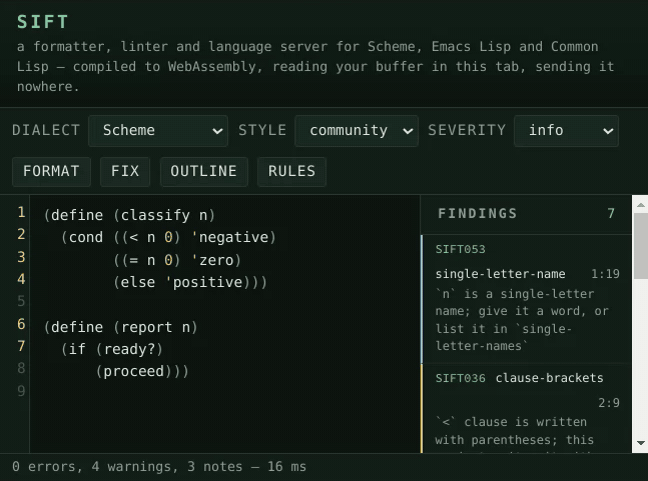

# SPDX-License-Identifier: MIT
# Copyright © Josep Bigorra <jjbigorra@gmail.com>

#+title: sift
#+subtitle: a formatter, linter and language server for Scheme, Emacs Lisp and Common Lisp
#+author: Josep Bigorra
#+email: jjbigorra@gmail.com
#+options: toc:2 num:nil
#+language: en
#+description: A dialect-aware formatter, linter and language server for Scheme, Emacs Lisp and Common Lisp. Formats and lints without ever losing a comment, a blank line or an apostrophe.
#+keywords: scheme emacs-lisp common-lisp formatter linter lsp guile emacs

*The Lisp formatter, linter and language server that never loses a byte.*

[[https://github.com/jjba23/sift/actions/workflows/ci.yml][https://github.com/jjba23/sift/actions/workflows/ci.yml/badge.svg]] [[https://github.com/jjba23/sift/releases][https://img.shields.io/badge/release-1.21.0-2f6f4f.svg]] [[https://opensource.org/license/mit][https://img.shields.io/badge/license-MIT-2f6f4f.svg]] [[https://www.gnu.org/software/guile/][https://img.shields.io/badge/Guile-3.0%2B-1e5b3a.svg]] [[https://github.com/jjba23/guix-jointhefreeworld][https://img.shields.io/badge/Guix-channel-6f4e9c.svg]] [[https://github.com/jjba23/nix-jointhefreeworld][https://img.shields.io/badge/Nix-flake-5277c3.svg]] [[https://microsoft.github.io/language-server-protocol/][https://img.shields.io/badge/LSP-server-2f6f4f.svg]] [[file:doc/rules.org][https://img.shields.io/badge/rules-92-2f6f4f.svg]]

sift reads a Lisp file, tells you what is wrong with it, and rewrites the
whitespace.  It does that without ever losing a comment, a blank line or an
apostrophe — because a formatter you have to re-read is a formatter you stop
running.

It speaks the three Lisps people actually write — Scheme, Emacs Lisp and
Common Lisp — and reads each one as itself rather than as a compromise
between them.

[[file:assets/sift-demo.gif]]

Install it with ~guix install sift~ (or ~nix run~), or
[[#quick-start][clone the repository]] and run ~./bin/sift version~: Guile 3.0 is
all it needs, and ~sift doctor~ will tell you what it found.

It is also a language server (~sift lsp~), which means the same findings, the
same fixes and the same formatting reach Emacs through Eglot, Neovim, and any
editor that speaks LSP — one integration instead of four.

sift is written in Guile Scheme, ships as one executable plus one Emacs
package, and is licensed MIT.  It is for people who have decided that Lisp is
worth formatting properly, and who would like the formatter to agree.

#+begin_quote
*Check, format, lint*  ~sift check~ prints the
patch it would make and exits 1; ~sift format~ prints the formatted file;
~sift lint~ names the rule that fired, its severity and its position.  These
are the same answers your editor and your pipeline get.  Every line in that
recording is real output, on files small enough to read in the picture.
#+end_quote

* It's for you Lispers, Schemers and Emacsen
:PROPERTIES:
:CUSTOM_ID: audience
:END:

- *People learning Lisp, Scheme or Emacs Lisp* 🩷
- *Guile and Guix hackers* whose ~cond~ clauses are written with square
  brackets, and who want a formatter that agrees with the code base next door
  instead of re-deciding it.
- *Emacs package authors* who want the docstring, ~lexical-binding~,
  ~interactive~ and ~provide~ rules in Flymake *and* in CI, from one tool
  instead of three.
- *Common Lisp projects* that would like package prefixes, ~LOOP~ keyword
  style and dangling parentheses respected rather than normalised away.
- *Maintainers of polyglot Lisp repositories* who would rather have one
  executable, one configuration file and one CI step than three of each.
- *Editor and tool authors* who need the findings as data: ~--format=json~,
  ~--format=sarif~, GitHub annotations, or ~sift lsp~.

#+begin_quote
If you have ever skipped reformatting a Lisp file because the formatter would
eat a comment, this is for you.
#+end_quote

* Why you might want it
:PROPERTIES:
:CUSTOM_ID: why
:END:

- *It never loses a byte.*  Comments, blank lines, ~#;~ datum comments,
  ~#.~ read-time forms and ~#<...>~ objects all come back exactly as they
  went in.  Formatting is a fixed point: run it twice and the second run
  changes nothing, which is asserted over every fixture in the test suite.
- *It knows which dialect it is looking at.*  Three dialects, one tool:
  character literals, read macros, ~#| ... |#~ block comments, ~#;~ datum
  comments, package prefixes, LOOP and docstring conventions follow the
  dialect rather than a compromise.  So does a square bracket, which is a
  vector in Emacs Lisp and a clause in Scheme, and ~#{ ... }#~, which is a
  symbol and only Guile reads.  Guile is what sift is written in and the
  dialect it knows best; the others are read, not guessed at.
- *Three jobs, three commands.*  Formatting, linting and fixing are separate
  on purpose: ~format~ prints, ~--write~ writes, ~lint~ reports, ~lint --fix~
  fixes, and ~ci~ asks the formatting question and the lint question in one
  go without ever touching the tree.
- *Sixty-three rules that say why.*  Every rule has a name, a stable code
  (~SIFT012~), a sentence, the dialects it applies to, an example, and its own
  test file.  ~sift explain RULE~ reads the reasoning from the program;
  [[file:doc/rules.org][doc/rules.org]] is the same thing as a book, generated from the rules
  themselves.
- *Fixes that refuse to guess.*  A rule's fix replaces exactly one range, and
  every fix of a run is thrown away if together they would introduce a parse
  error.  Nothing invents a missing delimiter, and nothing renames your code.
- *Silencing is a comment, and it stays where the code is.*
  ~;; sift:disable-next-line keyword-arguments~ switches one rule off for one
  line, ~disable~ for the rest of the form it sits in, and ~enable~ turns it
  back on.  Suppression is line-oriented and form-scoped on purpose: an
  exception list in a configuration file is a list nobody diffs, and a range
  comment outlives the code it was written for.
- *One language server, every editor.*  ~sift lsp~ speaks LSP over standard
  input and output: diagnostics, quickfixes and formatting, go to definition
  and references for all three dialects, an outline, completion, inlay hints
  that name a call's arguments, and a hover that describes a symbol or the
  rule under it.
- *Output for humans, editors and pipelines.*  The compile-style line that
  ~:make~ and ~compilation-mode~ parse, JSON for editors that want structure,
  SARIF 2.1.0 for code scanning, GitHub annotations for a pull request, and
  ~null~ for a script that only cares about the exit status.
- *Configuration you can check in.*  YAML that is data and never code, four
  layers from system to command line, and ~sift config show --verbose~ that
  tells you which layer won.
- *Hooks, a doctor, and a catalogue you can query.*  ~sift install-hooks~
  writes the ~pre-commit~ hook that runs ~ci~; ~sift doctor~ says which Guile
  it runs on, which library it loaded, how many rules it found and which
  configuration layer won; ~sift list-checkers~ prints the catalogue as a table
  and ~sift explain~ prints one rule's reasoning, both read out of the rule
  records rather than out of a document that might have drifted from them.
- *MIT, no strings.*  A formatter belongs in as many pipelines as possible
  without a copyright question in the way.

If none of that is your reason: it is a Lisp program that treats your Lisp
program as a tree of forms rather than as a file of text, and that turns out
to be most of it.

* A thirty-second tour
:PROPERTIES:
:CUSTOM_ID: quick-start
:END:

You need Guile 3.0 and nothing else.  Clone, and the launcher inside the
checkout runs the thing:

#+begin_src shell
git clone https://github.com/jjba23/sift.git
cd sift
./bin/sift version
#+end_src

Now a file that needs work:

#+begin_src shell
$ cat square.scm
(define (square x)
(* x x))

$ sift check square.scm
--- square.scm
+++ square.scm
@@ -1,2 +1,2 @@
 (define (square x)
-(* x x))
+  (* x x))
$ echo $?
1
#+end_src

~check~ answered the pipeline question — "would anything change?" — with a
status and a patch, and wrote nothing.  To make the change:

#+begin_src shell
$ sift format --write square.scm
$ sift check square.scm; echo $?
0
#+end_src

A file with something to say:

#+begin_src shell
$ cat small.scm
(define (go)
  (if (ready?)
      (proceed)))

$ sift lint small.scm
small.scm:2:4: warning: [if-without-else] `if` has no else branch; `when` says it once
1 file checked, 1 warning, 0 errors
#+end_src

Each line is ~file:line:column: severity: [rule] sentence~, which is what a
compilation buffer, a CI log and ~grep~ all understand.  Suggestions count
too — a deeply nested body is reported rather than rewritten:

#+begin_src shell
$ sift lint messy.scm
messy.scm:5:3: info: [wrap-in-let] this body form nests 10 deep; bind part of it
messy.scm:6:5: info: [wrap-in-let] this body form nests 9 deep; bind part of it
messy.scm:7:7: info: [wrap-in-let] this body form nests 8 deep; bind part of it
messy.scm:8:9: info: [wrap-in-let] this body form nests 7 deep; bind part of it
1 file checked, 0 warnings, 0 errors
#+end_src

To read what a rule means, ask it:

#+begin_src shell
$ sift explain if-without-else
CODE
SIFT012

NAME
if-without-else

DESCRIPTION
`if` with no else branch, where `when` expresses the intent

DIALECTS
scheme

SEVERITY
warning

FAILING EXAMPLE
(if (ready?) (go))

EXPECTED FIX
(when (ready?) (go))
#+end_src

And when you have stopped believing your own setup, ask sift what it thinks it
is doing:

#+begin_src shell
$ sift doctor
sift 1.21.0
  guile       3.0.11
  library     /home/joe/Hacking/sift/src
  rules       92
  dialects    scheme, elisp, cl

Configuration
  project  /home/joe/project/sift.yaml

Settings that are not the default
  brackets: square   # /home/joe/project/sift.yaml
  severity: warning   # /home/joe/project/sift.yaml

Try `sift ci .' to check a tree, or `sift explain RULE' to read a rule.
#+end_src

Then the two commands a newcomer reaches for next.  ~fix~ applies the fixes the
rules can prove and reports what is left:

#+begin_src shell
$ cat messy.scm
(define (f) (let ((x 1)) x))
(define (g)
  (if a b))

$ sift fix messy.scm
1 file checked, 0 warnings, 0 errors

$ cat messy.scm
(define (f) 1)
(define (g)
  (when a b))
#+end_src

It does not reformat, because formatting is ~format~'s job and a fix that moved
whitespace would touch every line of the patch you wanted to read.  And ~ci~ is
the question a pipeline asks, in one command and one status:

#+begin_src shell
$ sift ci .
--- ./go.scm
+++ ./go.scm
@@ -1,3 +1,3 @@
 (define (go)
-    (if (ready?)
-        (proceed)))
+  (if (ready?)
+    (proceed)))
./go.scm:2:6: warning: [if-without-else] `if` has no else branch; `when` says it once
1 file checked, 1 warning, 0 errors
$ echo $?
1
#+end_src

* Installing it
:PROPERTIES:
:CUSTOM_ID: install
:END:

sift needs Guile 3.0 or newer and nothing else at run time.  Emacs is optional
and only for the editor half.

** Requirements
:PROPERTIES:
:CUSTOM_ID: requirements
:END:

| What                                             | Needed for                                | Version |
|--------------------------------------------------+-------------------------------------------+---------|
| Guile                                            | the whole tool, at run time               | 3.0+    |
| Emacs                                            | the Emacs package in ~emacs/sift.el~      | 28.1+   |
| Guix or Nix                                      | installing the way your distribution does | any     |
| Vim and Node                                     | running the Vim and VS Code tests only    | any     |
| [[https://codeberg.org/jjba23/veritas][Veritas]] | running the test suite only               | dev     |

There is no C dependency, no build step, and no package manager required: the
program is Scheme source, loaded by the Guile you already have.

** From a checkout
:PROPERTIES:
:CUSTOM_ID: install-checkout
:END:

#+begin_src shell
git clone https://github.com/jjba23/sift.git
cd sift
./bin/sift version
#+end_src

~bin/sift~ is a small POSIX shell launcher: it resolves its own symlink chain,
puts the sibling ~src/~ on Guile's load path (or ~$SIFT_LOAD_PATH~, if you set
it), and hands the arguments to ~(sift cli)~.  If you would rather not have
the shell wrapper, the program is this:

#+begin_src scheme
#!/usr/bin/env guile
!#
(use-modules (sift cli))
(exit (sift-main (cdr (program-arguments))))
#+end_src

run with ~GUILE_LOAD_PATH~ pointing at ~src/~.  To install it into a prefix,
~maak install~ copies the library to ~$(prefix)/share/guile/site/3.0~ and the
launcher to ~$(prefix)/bin~; ~PREFIX=/usr/local~ is the default and
~maak uninstall~ undoes it.

On the first run Guile compiles the library and prints a few
~;;; note: ...~ lines to standard error while it does.  That is Guile's
auto-compilation talking, not sift: it stops once the cache is warm, and
~GUILE_AUTO_COMPILE=0~ silences it.

** With Guix
:PROPERTIES:
:CUSTOM_ID: install-guix
:END:

From a checkout, the shell command builds the package it ships:

#+begin_src shell
guix shell -f guix.scm -- sift version
guix build -f guix.scm        # or just the store path
#+end_src

To install it as a package, the [[https://github.com/jjba23/guix-jointhefreeworld][guix-jointhefreeworld]] channel carries it:

#+begin_src shell
guix install sift
#+end_src

A word about what is a dependency and what is not: sift itself is a library
plus a launcher and needs only Guile.  Veritas, the test framework, is needed
to run the tests and is a native input of the package for that reason — so
installing sift on a machine that will never run its tests does not install a
test framework.

** With Nix
:PROPERTIES:
:CUSTOM_ID: install-nix
:END:

The repository carries its own derivation, so Nix does not need a second
expression to build it:

#+begin_src shell
nix-build -E 'with import <nixpkgs> {}; callPackage ./default.nix { }'
./result/bin/sift version
#+end_src

It also carries a flake, which is the same derivation with the ways in
attached — a package, an app, a development shell, and a container image:

#+begin_src shell
nix run .#sift -- version        # in a checkout
nix run git+https://github.com/jjba23/sift -- version
nix build .#sift                 # ./result/bin/sift
nix develop                      # a shell with sift on PATH
nix build .#docker               # a loadable image, on Linux
#+end_src

The flake builds on Linux *and* on macOS (~x86_64-darwin~, ~aarch64-darwin~),
because sift is Guile and Scheme and nothing else: on a Mac, ~nix run
github:jjba23/sift~ is the shortest way to a sift that works.  The image is the
one thing that is Linux only, and it is simply absent on Darwin rather than
broken there.

The [[https://github.com/jjba23/nix-jointhefreeworld][nix-jointhefreeworld]] flake carries the same package, built from this
repository's own ~default.nix~:

#+begin_src shell
nix run git+https://github.com/jjba23/nix-jointhefreeworld#sift -- version
#+end_src

** In a container
:PROPERTIES:
:CUSTOM_ID: install-docker
:END:

The image is Debian's Guile, the library and the launcher, and nothing else —
there is no build step in it because a Scheme program has none.  Build it from
the checkout, or pull it:

#+begin_src shell
docker build --tag sift .                  # or: podman build --tag sift .
docker run --rm --volume "$PWD:/src" sift check .
#+end_src

The container's working directory is ~/src~, so a volume mounted there is the
tree sift reads; the entry point is ~sift~ itself, so the arguments after the
image are sift's arguments.  A whole-project run, a patch, a lint and the
language server (on standard input and output) all work the same way:

#+begin_src shell
docker run --rm --volume "$PWD:/src" sift ci .
docker run --rm --interactive --volume "$PWD:/src" sift lsp
#+end_src

~maak package-docker~ is the first command with the tags already on, and
~maak push-docker-latest~ / ~maak push-docker-tag~ publish it — the same three
tasks maak's own file has.  The image is also a flake output for a machine with
Nix and no engine: ~nix build .#docker~ writes a tarball that
~docker load < result~ loads.

Why a container at all, when sift needs only Guile: because the *other* end is
the one that decides.  On macOS there is no Guile that a script can count on,
and no Guix; there is Docker Desktop.  One image that works is worth more than
three install instructions.

** The Emacs package
:PROPERTIES:
:CUSTOM_ID: install-emacs
:END:

~emacs/sift.el~ is a single file with no dependencies beyond Emacs 28.1:

#+begin_src elisp
(add-to-list 'load-path "/path/to/sift/emacs")
(require 'sift)
#+end_src

The file carries the headers a package needs, so ~M-x package-install-file~ on
~emacs/sift.el~ works as well, if you would rather have it in
~package-user-dir~.

What you turn on after that is up to you — [[#emacs][the Emacs chapter]] has the two
paths, with and without Eglot, and the settings you can change.

** Verifying what you have
:PROPERTIES:
:CUSTOM_ID: install-doctor
:END:

#+begin_src shell
sift version   # the number, and that the program starts
sift doctor    # the Guile it runs on, the library it loaded, the rules it
               # has, and the configuration it decided on
#+end_src

* The command line
:PROPERTIES:
:CUSTOM_ID: cli
:END:

Every command, every option and every exit code is in
[[file:doc/cli.org][doc/cli.org]], which is the reference.  The short version: ~sift format~, ~sift
lint~ and ~sift check~ take files or standard input, ~sift ci~ is check and lint
in one command for a pipeline, and the status is 0 for clean, 1 for findings
and 2 for a usage error or a file that cannot be read.

* Which dialect is this?
:PROPERTIES:
:CUSTOM_ID: dialects
:END:

sift asks, in this order, and stops at the first answer:

1. ~--dialect~, or the ~dialect~ setting.
2. The extension: ~.scm~, ~.ss~, ~.sld~, ~.sls~ are Scheme; ~.el~ is Emacs
   Lisp; ~.lisp~, ~.cl~, ~.asd~, ~.lsp~ are Common Lisp.
3. The shebang: ~guile~ is Scheme, ~sbcl~, ~clisp~, ~ecl~ and ~ccl~ are Common
   Lisp, ~emacs~ is Emacs Lisp.
4. A marker in the first 200 lines: ~(in-package ...)~ or ~(defpackage ...)~
   is Common Lisp, ~(define-module ...)~ or ~(use-modules ...)~ is Scheme, a
   ~lexical-binding: t~ header is Emacs Lisp.
5. Otherwise it says so, and names the three dialects.  A tool that guesses
   the dialect is a tool that reformats your Common Lisp as Scheme one day.

An editor that knows the language is better informed than any of this: the
language server takes the identifier the client sends (~scheme~,
~emacs-lisp~, ~lisp~) and goes by that.

* Formatting
:PROPERTIES:
:CUSTOM_ID: formatting
:END:

The formatter normalises line endings and spacing, places closing delimiters,
computes indentation, optionally aligns inline comments, and preserves blank
lines up to the style's limits -- and refuses everything else: where the line
breaks are, what the strings say, what the escapes spell.  It is deterministic
and idempotent, and the suite formats every fixture twice to say so.
[[file:doc/formatting.org][doc/formatting.org]] is the page: the two styles, the three indentation rules,
every dialect's read syntax, and the four things it will not do.

* Linting
:PROPERTIES:
:CUSTOM_ID: linting
:END:

A rule is a record -- a name, a code, a description, the dialects it applies to,
a severity, a procedure and an example -- and the driver runs the ones the
dialect applies to, folds in the reader's own complaints, honours the
suppression comments, and reports the lot in the order your editor lists them.
There are 92 of them, listed one by one in [[file:doc/rules.org][doc/rules.org]].
[[file:doc/linting.org][doc/linting.org]] covers the rest: what a fix may touch, why a fix is thrown
away rather than guessed at, and how to silence a rule for a line or a form.

* The style guides it keeps
:PROPERTIES:
:CUSTOM_ID: style-guides
:END:

sift's style is not an invention: it is the common law of the three Lisp
communities, written down where it could be argued with.
[[file:doc/style.org][doc/style.org]] is the long form -- each choice, the alternative it beat, and why
-- including [[file:doc/style.org::#riastradh][which of Riastradh's rules sift keeps]] and what it declines, the
Emacs Lisp conventions that are really byte-compiler warnings, why Common Lisp
keeps its closers, and the square bracket a Scheme ~cond~ clause is written
with.  The settings a project is likely to hold differently are listed in
[[file:doc/configuration.org::#settings][the configuration page]]: a project that has decided should not have to fight
its formatter.

* In Emacs
:PROPERTIES:
:CUSTOM_ID: emacs
:END:

~emacs/sift.el~ is a thin package: Emacs carries the text to the executable and
the findings back, and every decision stays in one place.  It needs Emacs 28.1
or newer and no external package.  There are two ways in -- Flymake for the
rules, Eglot for code actions -- and [[file:doc/emacs.org][doc/emacs.org]] is the page:
[[file:doc/emacs.org::#emacs-flymake][the Flymake backend and its keymap]],
[[file:doc/emacs.org::#emacs-eglot][Eglot and the code actions]],
[[file:doc/emacs.org::#emacs-settings][every setting in the customization group]], and
[[file:doc/emacs.org::#elisp-indentation][why sift and ~TAB~ can disagree]] about a third-party macro.

* In other editors
:PROPERTIES:
:CUSTOM_ID: other-editors
:END:

Anything that speaks LSP can have the server; anything that reads a compiler's
output can have the program.  [[file:doc/editors.org][doc/editors.org]] has the details and the
recipes, and the ready-made ones live in the repository:

| Editor        | What to use                                                                                               |
|---------------+-----------------------------------------------------------------------------------------------------------|
| Neovim        | ~editors/vim/neovim.lua~ — a ~vim.lsp.start~ setup, no plugin                                             |
| Vim           | ~editors/vim/~ — ~:SiftLint~, ~:SiftFormat~, ~:SiftFix~, ~:SiftExplain~, and ~:compiler sift~ for ~:make~ |
| VS Code       | ~editors/vscode/~ — an extension with no build step and no dependencies                                   |
| Emacs         | ~emacs/sift.el~ — Flymake, or Eglot for code actions                                                      |
| Helix         | formatting on save through ~sift format --stdin~, and the linter in the pipeline                          |
| the browser   | [[file:web/README.org][web/]] — sift compiled to WebAssembly, so the buffer never leaves the tab; it is live at [[https://jointhefreeworld.org/sift/]] |
| anything else | ~--format=json~, ~--format=github~, or ~sift lsp~                                                         |

The human format is ~file:line:column: severity: [rule] message~, which Vim's
~:make~, Emacs's ~compilation-mode~ and most CI log viewers already understand.

** In the browser
:PROPERTIES:
:CUSTOM_ID: web
:END:

[[file:web/README.org][web/]] is sift doing the two jobs that are a function of a string — formatting
and linting — compiled to WebAssembly with [[https://spritely.institute/hoot/][Guile Hoot]], and an editor page
around it.  The same reader, the same formatter and all 92 rules run in
the tab; nothing is sent anywhere, because there is nowhere to send it.

It is live at [[https://jointhefreeworld.org/sift/]]: an editor on a page, with
the dialect, the style and the severity as controls, the findings in a panel you
can click into, an outline, a completion popup, inlay hints that name a call's
arguments, and a rules browser built from the same catalogue the command line
prints.

*** Why a compile, and not a port
:PROPERTIES:
:CUSTOM_ID: web-why
:END:

The obvious way to put a Lisp formatter in a browser is to write it again in
JavaScript.  That way lies a second formatter, and a second formatter is a second
style: the two agree until the first interesting file, and then the project has
to decide which of its own tools it believes.  So the source of truth stayed
where it is.  The tab runs the reader, the formatter, the lint driver and every
rule that ~bin/sift~ runs, because they are the same modules.

The whole contract between the page and the Scheme is one procedure of one string
to one string:

#+begin_src scheme
(web-request "{\"op\":\"lint\",\"source\":\"(if a b)\"}")
;; => "{\"ok\":true,\"result\":{\"warnings\":[…],\"counts\":{…}}}"
#+end_src

Everything the tab can do is that procedure — format, check, lint, fix, the rule
catalogue, and the four editor questions (hover, go to definition, completion,
outline) that are answered by [[#lsp-coverage][the language server's own analysis code]], asked
with an empty workspace.  Everything it cannot do is anything that needs a
filesystem, and there is no pretending otherwise: no directory to walk, no
~sift.yaml~, no save, no server.

*** What compiled, and what had to stand in
:PROPERTIES:
:CUSTOM_ID: web-compat
:END:

Hoot compiles R7RS and a subset of Guile, and the gap between that and what sift
uses is ~web/compat/~.  Four Guile libraries have stand-ins: ~format~,
~textual-ports~, ~threads~ (a tab is one thread, so ~(sift pool)~ takes its
sequential path) and ~ftw~ (~scandir~ answers nothing, because there are no
directories to walk — which is the truth about a tab and not a guess).

The interesting one was SRFI-13.  Twenty-six files in the core import it, Hoot
ships srfi-9, srfi-11 and srfi-14 and no SRFI-13, and Guile's own
~srfi/srfi-13.scm~ is written with a ~re-export~ Hoot does not implement — so a
browser build that reached for it would compile a re-export of names the target
does not define and stop there.  The answer is a stand-in of eleven procedures,
written against ~(scheme base)~, and a test that runs the browser's copy in a
second process and fails unless its format, lint and fix answers are byte-for-byte
the answers Guile's library gives.  A stand-in nobody compares is a second
implementation wearing a compatibility layer's clothes.

Four things could not be shimmed, and the source changed instead, in ways a
native build is no worse for: ~(sift strings)~ carries the four string
procedures R7RS leaves out, rather than importing a library the target may not
have; three ~(char-set …)~ call sites became predicates, because a character set
is an object R7RS does not have; one procedure takes its port in the body rather
than as a keyword default that would be evaluated for nothing; and the
filesystem question in ~(sift imports)~ asks whether this Scheme has ~stat~ and
~scandir~ rather than who is compiling it.

Nothing in ~src/sift/~ names the browser, Wasm or Hoot.  The dependency runs one
way, and eight tests hold it that way: the core does not know that a tab exists;
the facade's dependency on the core is still five modules; every Guile library in
the compiled closure has a stand-in; the SRFI-13 stand-in is the file a build
finds; it answers what Guile's own library answers, measured in a second process;
the page names no URL from the root of a site; every URL it names carries the
build stamp; and the editor asks for the wasm beside itself rather than at the
root.

*** What it costs
:PROPERTIES:
:CUSTOM_ID: web-cost
:END:

The module is 2.3 MB, which is a formatter, a linter and 92 rules on a
Wasm GC — a large page by the standards of a web page and a small one by the
standards of an editor.  Speed is the honest part of the experiment:

| Buffer    | ~format~ | ~lint~ |
|-----------+----------+--------|
| 300 chars | 17 ms    | 56 ms  |
| 1.2 kB    | 52 ms    | 145 ms |
| 6 kB      | 780 ms   | 1.2 s  |

A screenful is instant and the editor debounces the lint by 300 ms, so the first
two rows are hidden entirely; past two kilobytes you can feel it.  There is no
JIT, a record is allocated per node, and the reader allocates four records per
character, which is the cost of a Scheme on a Wasm GC rather than something the
facade can tune away.  If it matters, the request takes a ~checkers~ list, which
is how a page asks for less work.

*** What the experiment says
:PROPERTIES:
:CUSTOM_ID: web-verdict
:END:

Two questions were being asked.  Whether a real Scheme program — not a toy, a
formatter with a reader of its own and 92 rules — can be compiled into
something a tab runs: it can, with the caveats above, and the porting work was
one compatibility directory rather than a rewrite.  And whether the seam survives
contact: it did, and the test that says so is the useful one, because it runs
under Guile in the ordinary suite, with no browser and no Wasm runtime involved.

The boundary is the interesting part.  A tab has a buffer and no project, so two
rules cannot fire and say nothing rather than guessing, and the language server is
not in the tab at all — it is a process talking over standard input and output,
which a browser is not.  The experiment is the formatter and the linter, and that
turns out to be most of what a Lisp file needs while you are writing it.

*** Building and publishing it
:PROPERTIES:
:CUSTOM_ID: web-build
:END:

#+begin_src shell
./web/build.sh     # writes web/dist/, and finds a Hoot that works
maak web-serve     # then open http://localhost:8080/
maak web-deploy    # or copy it to the directory nginx serves
#+end_src

The build is one command because Hoot is not a library sift ships: it is the
compiler, needed once and never at run time, and finding it is the only hard part.
Hoot's compiled modules are bytecode and bytecode belongs to the Guile that
compiled it, so ~guix shell guile guile-hoot~ gives a toolchain that fails halfway
through a compile with an error from inside Hoot — ~web/build.sh~ compiles a
two-line program to find out whether its toolchain works, and asks Guix for
~guile-next guile-hoot~ when it does not.  [[file:web/README.org][web/README.org]] has the long version
of that, and of the two things the server contributes (a ~.wasm~ content type and
a trailing-slash redirect) and the one it has to be worked with (a two-day cache,
which is what the build stamp in every URL is for).

Publishing is a copy into ~/srv/http/jointhefreeworld.org/sift~ on the machine
that serves, the way the rest of that site is published: no ssh, no rsync, no
server to reload, because a file that is there is a file that is served.

* What the language server answers
:PROPERTIES:
:CUSTOM_ID: lsp-coverage
:END:

The whole of what ~sift lsp~ answers -- request by request, including the
requests it refuses, its code actions and the two limits that go with them --
is in [[file:doc/language-server.org][doc/language-server.org]].  The limits are worth repeating: a reference is
matched by name within one dialect, because sift expands no macro and follows
no import; and the project is read once per session, unless the editor says a
file changed.

* In a pipeline
:PROPERTIES:
:CUSTOM_ID: ci
:END:

One command asks both questions:

#+begin_src shell
sift ci src/ tests/
#+end_src

It checks the formatting, then lints, prints both reports in the format you
asked for, and exits 1 if either found something, 2 if it could not read or
parse a file.  It never writes and never fixes — a job that edits the tree it
is judging is a job nobody trusts.

** GitHub Actions
:PROPERTIES:
:CUSTOM_ID: github-actions
:END:

There is a reusable workflow, so most repositories need one file and no flags:

#+begin_src yaml
# .github/workflows/sift.yml
name: sift
on: [push, pull_request]
jobs:
  sift:
    uses: jjba23/sift/.github/workflows/sift.yml@v1.21.0
#+end_src

That annotates the diff with what it found and uploads the SARIF document to
code scanning, so a finding that was not fixed becomes an alert in the
Security tab rather than a line in a log nobody scrolls through again.  The
same repository also publishes a composite action, for a job that wants sift
as one step among its own:

#+begin_src yaml
- uses: jjba23/sift@v1.21.0
  with:
    paths: src/ tests/
    severity: warning
#+end_src

If you would rather spell the step out, ~--format=github~ writes workflow
commands instead of prose, so each finding lands as an annotation on the line
of the diff:

#+begin_src yaml
- name: sift
  run: ./bin/sift ci --format=github src/
#+end_src

#+begin_src text
::warning file=src/foo.scm,line=3,col=3,title=SIFT012 [if-without-else]::`if` has no else branch; `when` says it once
::error file=src/bar.scm,line=1,title=sift format::src/bar.scm would be reformatted by `sift format --write`
#+end_src

And ~--format=sarif~ writes one document for the whole run, which is what a
code scanning service expects:

#+begin_src yaml
- run: ./bin/sift ci --format=sarif src/ > sift.sarif
- uses: github/codeql-action/upload-sarif@v3
  if: always()
  with:
    sarif_file: sift.sarif
#+end_src

** A pre-commit hook
:PROPERTIES:
:CUSTOM_ID: pre-commit
:END:

#+begin_src shell
sift install-hooks            # writes .git/hooks/pre-commit, running `sift ci'
sift install-hooks --force    # replaces one that is already there
#+end_src

The hook runs whatever ~sift~ is on your ~PATH~; set ~SIFT~ in the hook's
environment to point at another copy.  If you use the
[[https://pre-commit.com][pre-commit]] framework instead, ~.pre-commit-hooks.yaml~ declares three hooks
— ~sift-format~ (rewrites), ~sift-check~ (fails) and ~sift-lint~ — so a
project can pick the one it wants:

#+begin_src yaml
repos:
  - repo: https://github.com/jjba23/sift
    rev: v1.21.0
    hooks: [{id: sift-format}, {id: sift-lint}]
#+end_src

* Running sift in parallel
:PROPERTIES:
:CUSTOM_ID: parallel
:END:

A run over a project is a run over one file at a time, so ~lint~, ~format~,
~check~ and ~ci~ spread the files over the processors and print the answers in
file order: a parallel run writes exactly the bytes a sequential one writes.
~SIFT_JOBS~ is the only knob, and the two runs that are never parallel are the
ones that write the files they read.  The knob, the two exceptions and why the
output is ordered are in [[file:doc/configuration.org::#parallel][doc/configuration.org]].

* Configuration
:PROPERTIES:
:CUSTOM_ID: configuration
:END:

A project's settings are a ~sift.yaml~, or a ~sift.scm~ it has trusted, read in
four layers and validated against one schema: a key sift does not have is
refused with its position rather than ignored, and ~sift config show --verbose~
says which layer won.  [[file:doc/configuration.org][doc/configuration.org]] has the whole of it -- the
discovery rules, the ~file-filter~, the trust model, and the settings the
language server reads out of the same files.

* Testing
:PROPERTIES:
:CUSTOM_ID: testing
:END:

Every half of the project is tested with the framework its own users already
have -- Veritas for the library, ERT for the Emacs package, Vim and Node for the
editor integrations -- and none of it is a smoke test.
[[file:doc/development.org::#testing][doc/development.org]] is the page: the ~maak~ tasks, what the benchmarks
measure, and what the suite actually asserts.

* How it is built
:PROPERTIES:
:CUSTOM_ID: architecture
:END:

~src/sift/~ is one module per job, and the dependencies point one way:
~records~ is a vocabulary, ~reader~ and ~format~ use it, the checkers use
~records~ and ~check/base~, ~lint~ assembles them, ~render~ prints their
findings, ~lsp~ says the same findings over a protocol, and ~cli~ wires the lot
to the command line.  Nothing in ~format~ or in a checker knows about ports or
exit codes.  The module map, and what each one owns, is
[[file:doc/development.org::#architecture][doc/development.org]].

* What sift believes
:PROPERTIES:
:CUSTOM_ID: beliefs
:END:

Six convictions the code is measured against: a file is not a string; a tool you
have to check is a tool you stop running; the author decides what the code says
and the tool decides where the whitespace goes; a dialect is a language, not a
variant; say what you can prove and refuse the rest; and everything a program
says should be available as data.  [[file:doc/design.org][doc/design.org]] states them, and then
the decisions that follow -- a reader of its own, one walk with the answers kept,
fuzzy formatting instead of pretty-printing, and a YAML reader small enough to
audit.

* What is left
:PROPERTIES:
:CUSTOM_ID: limits
:END:

sift does not resolve macros, does not type-check, and does not know your
project's conventions.  It reports; you decide.  That is not modesty — it is
the only way a linter stays useful to a project it has never seen.  Where it
can be wrong it says so: ~wrap-in-let~ is a suggestion, ~keyword-arguments~
counts, and the thresholds are settings.  The language server answers the
requests [[file:doc/language-server.org][the language server page]] lists, and refuses
the rest with "method not found" rather than guessing.

* Contributing
:PROPERTIES:
:CUSTOM_ID: contributing
:END:

Yes, please.  This is a small project with a long list of Lisp dialects it
would like to be better at, and every one of these is a real contribution:

- *A bug report.*  For a formatter the useful report is the input, the output
  you expected, and ~sift version~ plus the first section of ~sift doctor~ —
  which dialect was chosen and which rules ran is usually the answer by
  itself.  A file that sift refuses to parse is a bug even if the file is
  broken: the message should say where.
- *A rule.*  Every rule is one record and one test file, and the catalogue,
  the documentation and the editor integrations pick it up from there.  A
  rule needs a name, a code (take the next free one), a sentence, the dialects
  it applies to, a severity, an example, and the three test cases — one that
  passes, one that fails at a known line and column, and, if you can write the
  fix safely, the fixed text and a re-lint that must find nothing.
- *A dialect detail.*  An escape that is spelled differently, a comment syntax
  that is not where it should be, a form whose body indents by something other
  than two — [[file:tests/reader-scheme.scm][tests/reader-scheme.scm]] and [[file:tests/format-scheme.scm][tests/format-scheme.scm]] are where the
  behaviour is written down.
- *An editor integration.*  Neovim, Vim and VS Code each have a directory and
  a test in that editor's own tool.  Another editor is a directory more.
- *A word in the documentation.*  The README, [[file:doc/style.org][the style document]] and the
  rule descriptions are written by hand and read by people deciding whether
  to trust the tool.  If a sentence here made you hesitate, it is worth a
  patch.

** A first patch, in order
:PROPERTIES:
:CUSTOM_ID: first-patch
:END:

1. Read [[file:doc/style.org][doc/style.org]] — it is the argument the rules implement, and a rule
   that disagrees with it is the interesting kind of bug report.
2. Run the suite once before you change anything, so that a failure later is
   yours to explain: ~maak test~ (and ~maak emacs-test~ if you touched the
   package).
3. Add the rule or the fix with its test file under ~tests/checkers/~, then
   ~maak self-check~, ~maak check~ and ~maak fixture-check~.
4. Send it as a pull request, or as a patch — see below.

The rules of the house are the project's own style, and the project formats
itself:

#+begin_src shell
maak fmt           # format sift's own sources with sift
maak test          # the Veritas suite
maak check         # compile every module
maak self-check    # sift's sources are formatted by sift
maak fixture-check # the golden corpus still round-trips
maak docs          # regenerate doc/rules.org
maak emacs-check   # byte-compile the package, warnings are errors
maak emacs-test    # ERT
maak editors-check # Vim in batch, Node over the VS Code logic
#+end_src

Docstrings are Texinfo-flavoured (~@var{}~, ~@code{}~), the first line is a
sentence, and every paragraph explains *why* as well as what — that is the
only reason this project has a README you can read without a spec next to it.

A commit message is a type and then a sentence: ~feat:~ for something that was
not there before, ~fix:~ for something that was wrong, and ~docs:~, ~test:~,
~refactor:~, ~build:~, ~ci:~ or ~chore:~ for everything else, scoped in
parentheses when it narrows the subject (~fix(lsp):~, ~refactor(reader):~).
The reader that matters is the one scrolling ~git log~ for the change that
broke their build, and a type is what lets them skip nine commits out of ten
without opening one.

Patches are welcome as a pull request on
[[https://github.com/jjba23/sift][GitHub]] or as a patch sent with ~git format-patch~ and ~git send-email~, which
is how the author usually works.  Be kind: the code review is about the code.

Questions are welcome as issues too, and they are not a lesser contribution.
If this README did not answer yours, the README is the thing that needs the
patch, and saying so is the most useful bug report of all.

* Further reading
:PROPERTIES:
:CUSTOM_ID: further-reading
:END:

** In this repository

- [[file:doc/style.org][doc/style.org]] — the style, the choices behind it, why each one is
  idiomatic Lisp, and [[file:doc/style.org::#riastradh][which of Riastradh's rules sift keeps]].
- [[file:doc/rules.org][doc/rules.org]] — every rule, with its code, in a document generated from
  the rules themselves.
- [[file:doc/editors.org][doc/editors.org]] — Emacs, Eglot, Neovim, Vim, VS Code, Helix, pre-commit,
  and the two CI shapes.
- [[file:doc/cli.org][doc/cli.org]] — every command, every option, and what each exit status means.
- [[file:doc/language-server.org][doc/language-server.org]] — every request ~sift lsp~ answers, the ones it
  refuses, and the code actions it offers.
- [[file:doc/configuration.org][doc/configuration.org]] — the two configuration files, the four layers they
  are read in, the settings a project is likely to change, and the one knob
  that is not a setting.
- [[file:doc/formatting.org][doc/formatting.org]] — the formatter: the two styles, the three indentation
  rules, and every dialect's read syntax.
- [[file:doc/linting.org][doc/linting.org]] — the lint driver, what a fix may touch, and how a rule is
  silenced.
- [[file:doc/emacs.org][doc/emacs.org]] — the Emacs package, both ways in, and every setting.
- [[file:doc/design.org][doc/design.org]] — the convictions, and the decisions they produced.
- [[file:doc/development.org][doc/development.org]] — the ~maak~ gates, what the benchmarks measure, and
  the module map.
- [[file:web/README.org][web/README.org]] — the browser build: the seam, the protocol, the
  compatibility layer, and the numbers.
- ~sift explain RULE~ — the same reasoning, one rule at a time, from the
  program.
- ~sift list-checkers~ — the catalogue as a table, filtered by dialect.
- [[file:emacs/sift.el][emacs/sift.el]] — the package, with its commentary at the top.

** Outside it

- [[http://mumble.net/~campbell/scheme/style.txt][Riastradh's Lisp Style Rules]] — Taylor R. Campbell's guide, and the
  sharpest short argument for the style sift enforces;
  [[file:doc/style.org::#riastradh][which of its rules sift keeps]] is in the style page.
- [[https://google.github.io/styleguide/lispguide.xml][Google's Common Lisp style guide]] — the other modern reference, and the
  source of the community style sift uses for Common Lisp.
- [[https://small.r7rs.org/][R7RS-small]] — the report sift reads Scheme against, and the reason the
  compatibility layer is written in the subset it is.
- [[https://srfi.schemers.org/srfi-13/][SRFI 13]] — the string library the command line gets from Guile and a browser
  build gets from eleven procedures of its own.
- [[https://www.gnu.org/software/emacs/manual/html_node/elisp/Documentation-Tips.html][The Emacs Lisp manual's docstring tips]] — the conventions behind the Emacs
  Lisp rules, which are warnings about what a byte-compiler complains about
  rather than opinions about taste.
- [[https://microsoft.github.io/language-server-protocol/][The language server protocol]] — what ~sift lsp~ speaks, and what it refuses.
- [[https://spritely.institute/hoot/][Guile Hoot]] — the compiler behind [[#web][the browser build]].

* License
:PROPERTIES:
:CUSTOM_ID: license
:END:

sift is free software under the MIT license.  See [[file:LICENSE][LICENSE]]: it
is a short, permissive license, and a formatter belongs in as many pipelines as
possible without a copyright question in the way.
