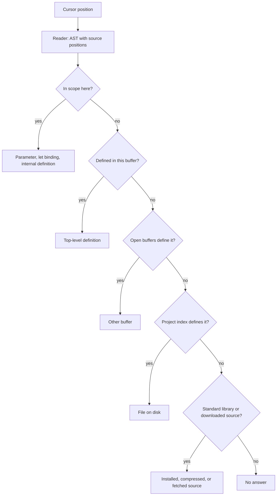
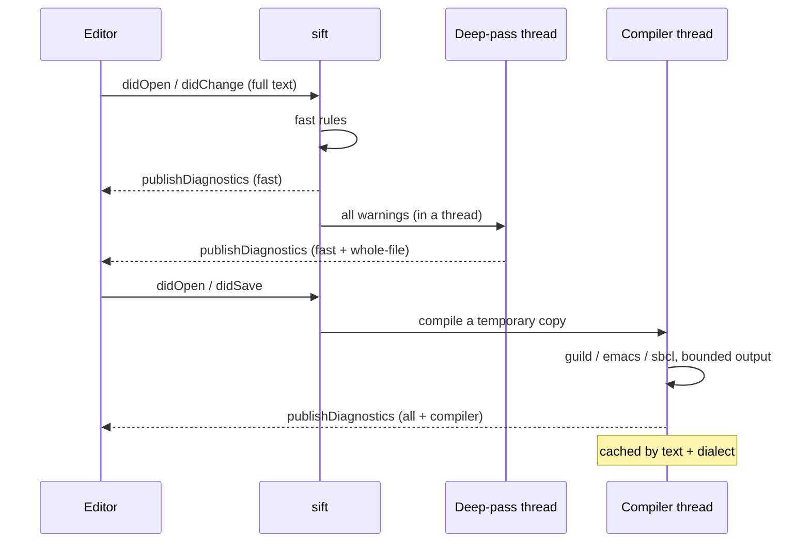
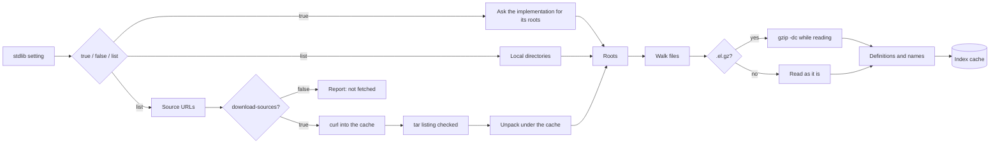
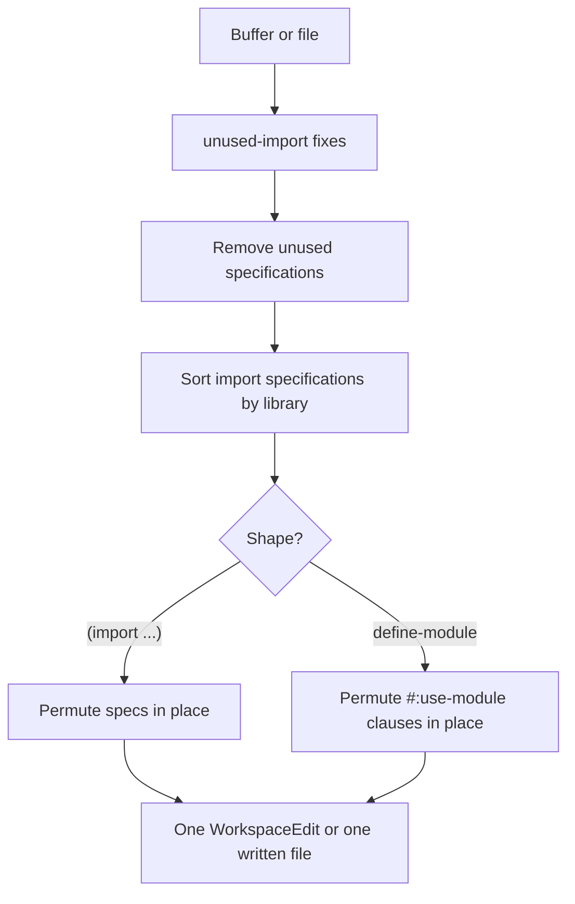
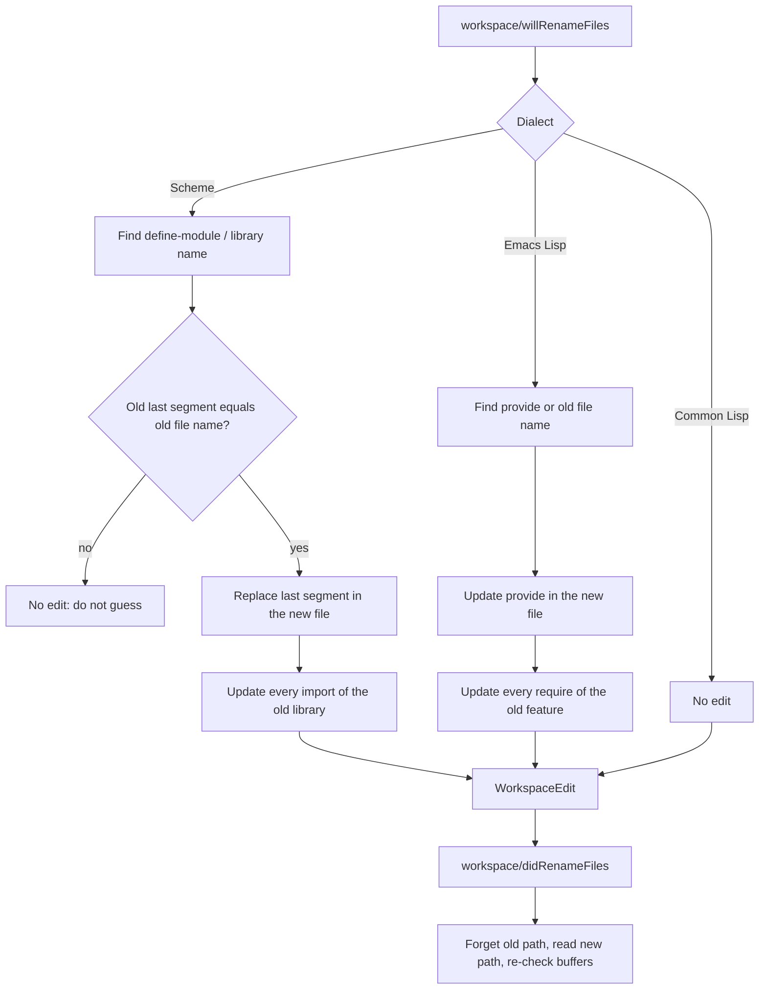

# How sift works

These are the moving parts a reader usually has to reconstruct from the source:
where a name is resolved, why a second diagnostic report arrives after the
first, how the standard library is found, and what a file rename changes.  The
diagrams are the map; the Org pages are the reference.

## Navigation: from a cursor to a definition

A jump is answered from the narrowest thing that knows the answer, and it only
widens when it has to.  The buffer is the authority, the project is indexed
beside it, and the library is the last and largest place a name can live.

Why this is good: a jump almost never scans the project, because resolution
stops at the first place a reader would look.  The project index is read once
per session and refreshed on save or a watched file change; the standard
library is read once per installation and cached.

## Diagnostics: the fast answer, then the whole-file answer

Some rules can be answered while the reader is typing; others need the whole
file, and the compiler needs a process.  The editor gets the cheap answer
immediately, and each slower answer replaces it only for the text it was
computed from.

Why this is good: a keystroke never waits for a compiler, a second report is
sent only when it says something new, and a report about text the editor no
longer has is dropped instead of drawn over the wrong buffer.

## Standard library: discovery, compression and the cache

The library is the largest code base a jump can enter and the one the project
does not contain.  It is indexed from the implementation's own source, the
package trees a dialect installs beside it, and optionally a source archive
named by URL.

Why this is good: the first index is expensive and the second session is a
cache read.  A compressed source is read through the decompressor the platform
already has, a URL is fetched only when the project asked for network access,
and an archive is listed and refused before it is extracted if a member would
leave the extraction directory.

## Organize imports: remove, then sort, in place

The two operations are independent, are on by default, and are the same
question in the editor and on the command line.

Why this is good: sorting is a permutation of the existing spans, not a
pretty-print, so a one-line import form stays one line and a comment between
clauses stays where it is.  `optimize-imports` and `sort-imports` can be turned
off independently, and the standard `source.organizeImports` action respects
both.

## Rename a file: the module follows the name

A file rename asks the dialect what a module is.  Scheme and Emacs Lisp have an
answer; Common Lisp does not pretend a package is a file.

Why this is good: the rename is conservative.  A module whose name has nothing
to do with its file is left alone, a package is not renamed because a file
moved, and the index is corrected when the move actually happens rather than
guessed before it.

## Cross-platform notes

sift is written for POSIX systems, with Linux and macOS as the supported
targets.  The differences are in where a cache lives and which optional tools
are present, not in the library's behaviour.

| Concern | Linux | macOS |
|---|---|---|
| Cache | `$XDG_CACHE_HOME/sift`, else `~/.cache/sift` | `$XDG_CACHE_HOME/sift`, else `~/Library/Caches/sift` |
| Compressed source | `gzip` | `gzip` |
| Source download | `curl`, `tar` | `curl`, `tar` (bsdtar) |
| Compiler second opinion | `guild`, `emacs`, `sbcl` | `guild`, `emacs`, `sbcl` |
| Process capture | POSIX `sh -c 'exec "$@" 2>&1'` | the same |

A missing optional tool is reported, not fatal: without `gzip` a compressed
source is not read, without `curl`/`tar` a URL source is not fetched, and
without a compiler the second opinion is simply absent.  The core formatter,
linter and navigation over uncompressed files need only Guile 3.0.

Back to the [[file:../README.org][README]].
